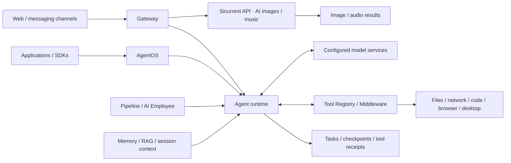

<h1 align="center">macs</h1>

<p align="center"><a href="README.md">简体中文</a> | <strong>English</strong></p>

<p align="center">
  <strong>Multi-Agent Collaboration System</strong><br>
  Help Agents deliver verifiable work and turn experience into reusable capabilities
</p>

<p align="center">
  <a href="go.mod"></a>
  <a href="#architecture"></a>
  <a href="#data-and-deployment"></a>
  <a href="LICENSE"></a>
</p>

<p align="center">
  <a href="#architecture">Architecture</a> ·
  <a href="#screenshots-and-demos">Screenshots</a> ·
  <a href="#core-strengths">Core strengths</a> ·
  <a href="#positioning-and-comparison">Positioning</a> ·
  <a href="#capabilities">Capabilities</a> ·
  <a href="https://github.com/niqinggood/sicurrent-soft/releases/tag/downloads">Download builds</a> ·
  <a href="#quick-start">Quick start</a> ·
  <a href="#build-and-run-the-executable">Build and run</a> ·
  <a href="#memory-and-forgetting">Memory</a> ·
  <a href="#business-system-integration">Integration</a> ·
  <a href="#core-code-walkthrough">Code walkthrough</a> ·
  <a href="#documentation">Documentation</a>
</p>

---

## What is macs?

**macs is an AI Agent work system you can deploy yourself.** Describe a goal in natural language and let Agents inspect information, understand a project, use tools, coordinate execution, and deliver files. Applications can also invoke these capabilities through an API.

The product provides two main modes:

- **Agent mode:** interpret goals, plan tasks, use tools, and coordinate multiple agents to perform complex work and verify deliverables.
- **Conversational mode:** everyday questions, writing, and AI image and music generation integrated through the **Sicurrent API**. Image model examples include Nano Banana and `gpt-image2` from the platform catalog; availability depends on the account's model list.

The application is primarily written in Go and embeds its Web UI and built-in Skills. The same Agent tools and Skills can support personal tasks, specialist teams, and workflows, or become available to existing applications through AgentOS.

The formal product name is **macs**, its Chinese name is **麦卡斯**, and its nickname is **openkitty**. Existing technical names such as `openkitty.exe`, `openkitty-config.yaml`, and `OPENKITTY_*` remain for compatibility.

| Use | What it supports |
| --- | --- |
| Personal assistant | Questions, research, coding, file processing, knowledge retrieval, and everyday work |
| Project collaboration | Agents with different responsibilities for research, writing, analysis, and review |
| Automation workbench | Document templates, browser and desktop actions, and reusable successful procedures |
| Business task service | Asynchronous task submission, status, progress, results, and deliverables for existing applications |

<p align="center">
  <a href="docs/images/showcase/overview.png"></a>
  <br><sub>macs workbench · V1.1.8 demo interface, click for the full-size image</sub>
</p>

## Architecture



| Concept | What it does |
| --- | --- |
| Agent | Interprets the goal, decides what to do next, uses tools, and checks results |
| Tool | Performs one concrete action, such as reading a file, searching, or running tests |
| Skill | Supplies knowledge, procedures, and supporting resources for a particular kind of work |
| Pipeline | Organizes repeatable workflows with step inputs, expected outputs, checks, and saved progress |
| AI Employee | Configures a business role with responsibilities, Skills, and workflows, triggered by messages or schedules |
| AgentOS | Lets applications call Agent roles through an API, run tasks in the background, track progress, retrieve results, and recover interrupted work |

| Path | Responsibility |
| --- | --- |
| [`cmd/macs/`](cmd/macs/) | Executable entry point and version injection |
| [`internal/app/`](internal/app/) | Assembly, Gateway, and coordination across domains |
| [`internal/agentloop/`](internal/agentloop/) | Turn state, leases, and recovery |
| [`internal/agentos/`](internal/agentos/) | Protocol, durable tasks, and domain models |
| [`internal/pipeline/`](internal/pipeline/) | Checkpoints and input/output contracts |
| [`internal/memory/`](internal/memory/) | Long-term items, recall, corrections, and forgetting |
| [`internal/tools/`](internal/tools/) | Workspace, network, content, development, and interface tools |
| [`internal/toolregistry/`](internal/toolregistry/) | Discovery, registration, filtering, and execution |
| [`pkg/`](pkg/) | Reusable public Go capabilities |
| [`web/`](web/) | Native Web UI without a bundling step |
| [`builtin/`](builtin/), [`default-skills/`](default-skills/) | Embedded Skills and runtime resources |
| [`scripts/`](scripts/) | Build, quality, and publishing entry points |

## Screenshots and demos

See the interfaces for expert teams, workflow orchestration, knowledge retrieval, and Word document delivery. Click an image to open it at full size, or explore the [complete screenshot gallery](docs/showcase.en.md). These examples use the Chinese interface.

<table>
  <tr>
    <td width="50%" valign="top">
      <a href="docs/images/showcase/expert-teams.png"></a>
      <p><strong>Multi-Agent expert teams</strong><br>Organize research, coding, content, and review roles.</p>
    </td>
    <td width="50%" valign="top">
      <a href="docs/images/showcase/pipelines.png"></a>
      <p><strong>Reusable workflows</strong><br>Turn business steps into configurable, trackable Pipelines.</p>
    </td>
  </tr>
  <tr>
    <td width="50%" valign="top">
      <a href="docs/images/showcase/knowledge.png"></a>
      <p><strong>Knowledge retrieval and RAG</strong><br>Find answers in imported material and inspect their sources.</p>
    </td>
    <td width="50%" valign="top">
      <a href="docs/images/showcase/document-output.png"></a>
      <p><strong>Document automation and delivery</strong><br>Review mappings, preview Word results, and download files.</p>
    </td>
  </tr>
</table>

[Explore all 8 screenshots →](docs/showcase.en.md) · [简体中文图集](docs/showcase.md)

## Core strengths

**macs brings natural-language tasks, real tool execution, recoverable workflows, result verification, and reusable experience into one deployable Agent system.** Coding, networking, and document processing are ways that system performs work.

### 1. From personal tasks to team workflows and business applications

Tools, Skills, and procedures validated in the Web workbench can also support specialist teams and Pipelines, or serve applications through AgentOS. For example, a report-generation procedure can be used directly by a person or configured as a business role that accepts material, exposes progress, and returns a report to an existing application.

### 2. Stateful long tasks with recovery and inspectable results

Applications can inspect task state and progress, add requirements during execution, or cancel work. macs saves task state, checkpoints, and tool execution records to support recovery and result inspection. Pipelines can check step inputs and outputs and send unsuitable results back for rework. Recovery follows model and tool execution boundaries; writes with uncertain outcomes stop automatic replay.

### 3. Let Agents make judgments and run fixed steps by explicit rules

Agents interpret material, assess problems, and explore solutions. Reviewed fixed steps can be carried out by workflows or dedicated tools. For example, an Agent proposes Word template field mappings, and the DOCX engine fills the document and checks its structure and completeness. Once verified, the mapping can be saved and reused with new business data.

### 4. Reuse preferences, source material, and successful methods

Memory retains applicable preferences and experience; RAG retrieves source material; Skills organize methods; template profiles retain mapping rules. `workflow_learner` can compile successful `computer` sessions into parameterized recipes with success assertions. Memory can be corrected and forgotten. Reuse still requires verification, and not every task automatically becomes a skill.

### 5. Deploy it yourself and adapt it to your business

The Go application embeds the Web UI and built-in Skills and can use SQLite locally. Models, tools, and business logic can be extended through the provided interfaces and under the applicable license. Start on a personal computer and deploy as a service when needed. Browsers, Office/PDF conversion, and external platforms retain their own dependencies.

These characteristics are supported by existing implementation. Actual quality, time, and cost must be evaluated against the selected models and tasks.

## Positioning and comparison

macs is designed for people and teams that want to **operate their own deployment, adapt it to their business, and make Agent execution part of ongoing workflows**.

| Product | Direction emphasized in official information | macs characteristics to consider |
| --- | --- | --- |
| [OpenClaw](https://github.com/openclaw/openclaw) | A deployable assistant, messaging channels, Gateway, and extensions | Business Pipelines, durable task APIs, and document template delivery assembled in one product |
| [WorkBuddy](https://cloud.tencent.com/product/workbuddy) | An office workbench, expert collaboration, and Tencent ecosystem connections | An inspectable and adaptable Go implementation under its license, embedded Web UI, and configurable business capabilities |
| [Hermes Agent](https://github.com/NousResearch/hermes-agent) | Memory, learning from experience, and skill accumulation | Memory alongside business workflow contracts, template profiles, and UI recipes with assertions |
| [Codex](https://developers.openai.com/blog/codex-as-a-platform) | An Agent harness with CLI, SDK, and app-server integration | An assembled workbench with document processing, memory, messaging, and business orchestration |

Other products also offer memory, tools, collaboration, and business integration. This is a comparison of direction, not evidence that macs leads in coding success, speed, cost, or memory quality. Reviewed on 2026-10-16. See [positioning and evidence](docs/product-positioning.en.md) ([简体中文](docs/product-positioning.md)).

## Typical workflows

These examples show how the mechanisms support practical work. Results depend on the model, inputs, and runtime environment.

### 1. Coding: understand, modify, verify, and deliver

Agents can inspect repository structure and conventions, locate problems with search, LSP, AST, and dependency information, edit files, and run tests, builds, static checks, and behavioral acceptance checks.

- **Understand existing projects:** read project guidance, find symbols, inspect definitions and references, and determine change scope.
- **Perform engineering work:** edit files, coordinate cross-file changes, run commands, and use Git/worktree tools when applicable.
- **Use the real project environment:** work with the compilers, dependencies, and material already present on the deployment host.
- **Retain verification evidence:** `goal_verify` returns `PASS / FAIL / PARTIAL` for selected checks, including executable behavior assertions where configured.
- **Expose coding tasks to applications:** use AgentOS to submit work, inspect progress, add requirements, cancel execution, and retrieve results.

Examples include fixing an existing project, checking interface changes, batch edits, generating tests, and serving Agent tasks inside a development platform.

Source: [development tools](internal/tools/development/), [goal verification](docs/architecture/goal-verification.md), [runtime reliability](docs/architecture/runtime-reliability.md).

### 2. Research: connect discovery, reading, and subsequent work

Agents can search, read original material, inspect pages, and extract structured information before continuing with analysis, reports, knowledge retrieval, or business actions.

- Combine search, fetching, platform readers, and browser tools according to available backends.
- Use `agent_reach` for read-only search, reading, trends, and transcription routes through configured CLIs, APIs, or browsers, with native fallbacks.
- Use the browser and `computer` for interactive pages and available signed-in sessions.
- Connect internal APIs and services within configured access boundaries.

Examples include sourced research, industry monitoring, and preparing documents from business information. Platform access depends on the actual account, backend, and environment.

Source: [network tools](internal/tools/network/), [Agent Reach routing](internal/tools/network/agent_reach.go), [computer use](docs/architecture/computer-use.md).

### 3. Documents: work with existing templates and delivery requirements

The document engine supports structured filling of existing Word templates, alongside extraction and report generation.

- Inspect fields, content controls, bookmarks, and table structure.
- Fill using declarative mappings, stable cell addresses, and repeating rows.
- Review mappings before generation and check structure and unresolved content afterward, with previews and visual review when required.
- Save reusable profiles by template fingerprint for later batches with new input data.

Examples include fixed-format reports, contract information, records, batch forms, and presentation material. Mapping is based on document structure and data contracts.

Documentation: [user manual, Chinese](docs/macs-user-manual.md), [document automation, Chinese](docs/architecture/document-automation.md).

### 4. Automation: reuse successful interface work

The unified `computer` tool follows observation, action, and verification through existing browser and desktop backends. `workflow_learner` can derive input parameters and success assertions from a successful Session and replay and evaluate the resulting recipe with new inputs.

Changes to layouts, locators, or desktop environments require renewed observation and verification.

### 5. Memory: retain useful context and maintain it

Agents can selectively use long-term preferences, project conventions, and relevant historical references. Users can inspect sources, edit items, adjust recall, and forget information. Explicit lasting requirements and candidates requiring review receive different treatment. See [memory and forgetting](#memory-and-forgetting).

### 6. Integration: use the same capabilities in business workflows

Use Web and messaging channels directly, or integrate through AgentOS, SDKs, Pipelines, AI Employee, MCP, and tools. Long tasks have persistent state, idempotent submission, events, cancellation, and recovery mechanisms for integration with application lifecycles.

## Capabilities

| Area | What you can do |
| --- | --- |
| Chat and models | Ask questions or submit Agent tasks, review history, attach files, and configure cloud or local models |
| Agent execution | Interpret goals, plan steps, use tools, check results, and deliver files, with timeouts and cancellation |
| Coding | Search and analyze code, edit or refactor across files, run tests and builds, and verify completion |
| Research | Search and read pages and platform content, organize material, and check sources for research or reports |
| Memory | Retain preferences and project conventions, recall relevant history, and inspect, correct, or forget entries |
| RAG | Import material and retrieve relevant passages and sources by keyword or meaning, with optional enhanced retrieval and reranking |
| Documents | Extract content, fill Word templates, map fields, repeat table rows, and generate reports and office files |
| Browser and desktop | Observe interfaces, operate controls, verify results with screenshots, and turn successful operations into reusable workflows |
| Multi-agent teams | Assign roles to Agents, delegate tasks sequentially or in parallel, and reuse team templates |
| Pipeline | Arrange steps with inputs, expected outputs, conditions, and approvals, saving checkpoints for recovery |
| AI Employee | Configure role responsibilities, Skills, and workflows, and dispatch work from messages or schedules |
| Messaging channels | Use Agents through configured Feishu, WeChat, DingTalk, WeCom, QQ, Telegram, email, and other channels |
| Multimodal and media | Understand images and process speech; generate images (Nano Banana, gpt-image2, and other catalog models) and music through the Sicurrent API; use video features through configured services |
| MCP extensions | Connect external MCP services and use their tools and information in tasks |
| Skills | Install or activate domain Skills to reuse knowledge, procedures, and supporting resources |
| Hooks | Add custom handling at session, model-call, and tool-execution events |
| AgentOS and SDKs | Submit background tasks from applications, track progress, add requirements or cancel execution, and retrieve results and files |

Specific tools, channels, and media features require their respective services, accounts, or runtimes. Installing the main application does not configure every extension backend.

### AI images and music through the Sicurrent API

**The Web image and music generation features integrate part of Sicurrent's creative services through its API.** macs provides prompts and reference-image input, parameter selection, submission, progress tracking, image previews, audio playback, and downloads. Sicurrent handles generation model calls, generation tasks, and account settlement.

Sign in with a Sicurrent account, choose an image or music model from the platform catalog, and submit a visual description, musical direction, or lyrics. Images support aspect ratios and reference images; music supports songs and instrumentals. Image models such as Nano Banana and `gpt-image2`, music models, prices, and availability depend on the current platform catalog and account access. Usage is settled under Sicurrent's platform rules.

[Read the user manual, Chinese](docs/macs-user-manual.md) · [Inspect the API integration](internal/auth/platform_media.go)

## Quick start

### Download a compiled build

**Go directly to the [macs compiled downloads page](https://github.com/niqinggood/sicurrent-soft/releases/tag/downloads) if you do not need to build from source.** It provides the following macs 2.0.0 preview executables and a SHA-256 checksum list, without requiring Go or archive extraction. Choose files named `macs`; the page also hosts other software and older versions.

| System and processor | Download |
| --- | --- |
| Windows x64 | [macs-2.0.0-win.exe](https://github.com/niqinggood/sicurrent-soft/releases/download/downloads/macs-2.0.0-win.exe) |
| Linux x64 | [macs-2.0.0-linux-amd64](https://github.com/niqinggood/sicurrent-soft/releases/download/downloads/macs-2.0.0-linux-amd64) |
| Linux ARM64 | [macs-2.0.0-linux-arm64](https://github.com/niqinggood/sicurrent-soft/releases/download/downloads/macs-2.0.0-linux-arm64) |
| macOS Intel | [macs-2.0.0-mac-intel](https://github.com/niqinggood/sicurrent-soft/releases/download/downloads/macs-2.0.0-mac-intel) |
| macOS Apple Silicon (M series) | [macs-2.0.0-mac-apple](https://github.com/niqinggood/sicurrent-soft/releases/download/downloads/macs-2.0.0-mac-apple) |

Put the executable in a separate directory and start it as shown below. It looks for project and user configuration. If none exists on first run, it creates `openkitty-config.yaml` from the embedded template under `.openkitty/` in the user's home directory. Existing configuration is retained.

```powershell
# Windows / PowerShell
.\macs-2.0.0-win.exe --path . --port 8090
```

```bash
# Linux x64
chmod +x ./macs-2.0.0-linux-amd64
./macs-2.0.0-linux-amd64 --path . --port 8090
```

```bash
# macOS Apple Silicon; use macs-2.0.0-mac-intel on Intel Macs
chmod +x ./macs-2.0.0-mac-apple
./macs-2.0.0-mac-apple --path . --port 8090
```

On Linux ARM64, replace the example filename with `macs-2.0.0-linux-arm64`. Open `http://127.0.0.1:8090/web/`, using the actual address reported by the process, and configure a model as described below.

On Windows, you can also double-click the exe and open the address shown in its startup log. `--path .` selects the current directory as the workspace; replace `.` with your project path, quoting paths containing spaces. Press `Ctrl+C` in the startup terminal to stop the service. If port 8090 is occupied, choose another available `--port`.

### Using macs after download

1. **Open the workbench** at the `/web/` address shown in the startup log.
2. **Configure a model** in **Settings → Model configuration**: enter the provider endpoint, model name, and API key, save, and select a model for the assistant. Compatible APIs and existing local model services are supported; see the example below.
3. **Choose a mode**: use chat for questions; select Agent mode for files, coding, research, and multi-step work, with the correct workspace.
4. **Describe the goal and expected output**, such as a Markdown summary of the workspace material with conclusions, source files, and unresolved questions. Review results and delivered files in the conversation.
5. **Add capabilities as needed**: activate a Skill with `@SkillName`, or configure expert teams, knowledge bases, and workflows. Image and music generation require a configured Sicurrent account and available services.

Start with a simple question, then a small Agent task. The [full user manual, Chinese](docs/macs-user-manual.md) covers models, memory, document automation, and backups.

Optional archives with the configuration template, build record, and complete license material remain on the release page. Read the license notices before use. See the release notes for validation details: Linux and macOS executables are cross-compiled and have not been tested on those systems. Configure external browsers, model services, and Office/PDF conversion dependencies as needed.

### 1. Get the source

Source builds require Git and **Go 1.26**. The Web UI is native HTML/CSS/JavaScript and has no frontend bundling step.

```bash
git clone https://github.com/niqinggood/macs.git
cd macs
```

### 2. Copy configuration and start

Copy the template on first use. Keep an existing personal configuration and start with that file if already configured.

Windows / PowerShell:

```powershell
Copy-Item .\openkitty-config.template.yaml .\openkitty-config.yaml
go run ./cmd/macs --config .\openkitty-config.yaml --path . --port 8090
```

Linux / macOS:

```bash
cp openkitty-config.template.yaml openkitty-config.yaml
go run ./cmd/macs --config ./openkitty-config.yaml --path . --port 8090
```

`cmd/macs` is the primary executable entry point. `cmd/openkitty` remains available for existing commands. Configuration filenames, data directories, and environment variables retain their compatibility names.

Open `http://127.0.0.1:8090/web/`, using the actual address reported by the process. The template listens on `127.0.0.1:8080`; the example overrides its port to 8090. Existing deployments retain their own protocol, listener, and authentication settings.

The Web UI includes a **中文 / EN** switch. Some extended pages and longer help content are not fully translated yet.

### 3. Configure an available model

In Web settings, configure a provider endpoint, model name, and credentials. Select a model for the assistant or inherit the current default. Existing Ollama, vLLM, or compatible services can be configured by their actual endpoints. Install and start local model services and prepare models separately.

Model keys can reference environment variables. For example, configure a compatible service in your existing `model_cfg`:

```yaml
default_model: my-model
model_cfg:
  my-model:
    type: openai
    base_url: https://your-model-provider.example/v1
    model_name: REPLACE_WITH_MODEL_NAME
    api_key_env: MACS_MODEL_API_KEY
    max_tokens: 4096
```

Set the variable in the startup terminal before starting or restarting macs:

```powershell
# Windows / PowerShell
$env:MACS_MODEL_API_KEY = "REPLACE_WITH_YOUR_MODEL_API_KEY"
```

```bash
# Linux / macOS
export MACS_MODEL_API_KEY='REPLACE_WITH_YOUR_MODEL_API_KEY'
```

Replace placeholders with your configuration. Edit an existing YAML section instead of appending duplicate top-level keys. An empty assistant `model` can inherit the current default text model. Already submitted tasks retain their model settings.

Details: [model configuration and user manual, Chinese](docs/macs-user-manual.md), [configuration template](openkitty-config.template.yaml).

### 4. Submit a first task

Start with clear inputs and delivery requirements:

```text
Read the material in the specified directory and create a Markdown summary.
Include the main conclusions, referenced files, and questions still requiring confirmation.
```

Use Agent mode for tools, Agent memory, and multi-step execution, with the required capabilities enabled. Simple chat and direct media generation have separate execution paths.

### Build and run the executable

Run these commands from the repository root, where `go.mod` is located, using **Go 1.26**. The first build downloads Go module dependencies automatically. Before the first run, copy the configuration template as shown above; keep an existing configuration file.

Windows / PowerShell:

```powershell
go run ./cmd/releaseguard
go build -buildvcs=false -trimpath -o macs.exe ./cmd/macs
.\macs.exe --config .\openkitty-config.yaml --path . --port 8090
```

Linux / macOS:

```bash
go run ./cmd/releaseguard
go build -buildvcs=false -trimpath -o macs ./cmd/macs
./macs --config ./openkitty-config.yaml --path . --port 8090
```

The output is `macs.exe` on Windows or `macs` on Linux/macOS, in the repository root. `go build` only compiles; run the resulting executable to start the server, then open `http://127.0.0.1:8090/web/`.

The Web UI and built-in Skills are embedded, so no `npm build` is required. Recompile after changing `web/`, `builtin/`, or other embedded resources. Configuration and runtime data remain outside the executable.

Running a compiled binary does not require Go. See the [build script guide](scripts/README.md) for release packaging, version injection, and cross-compilation. Existing packaging scripts retain `openkitty` compatibility filenames.

#### Windows batch builds: abuild_windows.bat

Open PowerShell in the source root. Install `go-winres` for Windows icons and version metadata. Download the Windows x64 version from the [official UPX releases](https://github.com/upx/upx/releases), then put the extracted `upx.exe` in PATH or the repository root. Keep the tool out of source control.

```powershell
go install github.com/tc-hib/go-winres@latest
.\abuild_windows.bat 2.0.0 require
.\openKitty-2.0.0-win.exe --path . --port 8090
```

`require` fails if UPX is missing, compression fails, or the integrity check fails. Double-clicking the batch file prompts for a version, defaulting to `2.0.0`, in `auto` mode: compress when UPX is found, otherwise report that the output is uncompressed. Use `off` to build without UPX.

| Command | Output |
| --- | --- |
| `.\abuild_windows.bat 2.0.0 require` | Windows x64: `openKitty.exe`, `openKitty-2.0.0-win.exe`; an optional archive when RAR is available |
| `.\abuild_windows.bat 2.0.0 off` | Windows x64 without UPX |
| `.\scripts\build\build_linux.bat 2.0.0 amd64` | Linux x64: `dist/openkitty_linux_amd64` |
| `.\scripts\build\build_linux.bat 2.0.0 arm64` | Linux ARM64: `dist/openkitty_linux_arm64` |
| `.\scripts\build\build_mac.bat 2.0.0 fast` | Both Intel and Apple Silicon macOS executables |

For another UPX location, set `$env:MACS_UPX = "C:\Tools\upx\upx.exe"` to your tool path. All scripts support `--help`. These commands run on Windows; copy Linux/macOS binaries to the appropriate system and grant execution permission with `chmod +x`. The macOS `release` mode runs the full quality gate and stops on failure; `fast` is for local builds and still runs the credential guard.

The scripts strip debug information and inject the version and UTC build date. UPX compression substantially changes the Windows exe size; the plain `go build` examples above do not run UPX. Electron desktop packaging is described separately in the [script guide](scripts/README.md).

Windows executables support double-click startup. Current macOS and Linux builds are command-line executables; grant execution permission and start from a terminal. Uniform desktop application packaging is still incomplete.

## Memory and forgetting

Memory is enabled by default. Change it in Web **Settings → Work & Memory → Agent Memory**, or through configuration:

```yaml
memory_config:
  enabled: true
```

Each assistant also has a `has_memory` setting. Changes apply to new tasks. Simple chat bypasses the Agent long-term recall path.

| Stage | Current mechanism |
| --- | --- |
| Retain | Explicit lasting requirements, user-maintained preferences and conventions, and applicable experience and summaries |
| Recall | Select by current question, scope, active state, and context budget; semantic recall requires an embedding backend |
| Maintain | Inspect sources, add and edit items, make corrections, and manage pinning and recall |
| Forget | Forgotten unified memory items leave automatic recall, with retraction protection against revival through older compatibility sources |

For example: “Remember that future project reports should be in English and include references.” Existing items can also be edited or forgotten in management. Explicit current instructions override long-term defaults.

Long-term items, messages, summaries, learning notes, and knowledge sources remain distinct. Source records help explain retrieved references, but do not prove the model used a particular item. Forgetting one item does not automatically erase all derived material.

Details, currently in Chinese: [memory service](docs/architecture/memory-service.md), [memory system summary](docs/architecture/memory-system-summary.md).

## Business system integration

**AgentOS is the macs task service for business applications.** An existing system can delegate document review, report generation, or code maintenance to a configured Agent role. macs handles the task in the background, while the application tracks progress, adds requirements, or retrieves results and files without keeping the original request open.

Integration uses an asynchronous task API: a newly accepted task returns `202 + task_id + links`. Use the returned links to query state, subscribe to progress, and retrieve results.

```text
Business application submits a task
    → receives task_id and query links
    → macs queues and executes model/tool calls
    → application queries snapshots or subscribes to task SSE
    → application receives terminal state, results, and artifacts
```

This supports:

- Configuring callable Agent roles with responsibilities, available tools, and expected inputs and outputs.
- Determining available roles and data ownership from the caller identity for different business services.
- Retrying submission with an idempotency key to avoid duplicate tasks.
- Inspecting progress, adding requirements during execution, and cancelling work.
- Saving task state, checkpoints, and tool execution records to continue work at recoverable execution boundaries.
- Integration through Go/Python SDKs or HTTP and SSE.

The following example follows the [AgentOS quick start](docs/agentos-quickstart.md), using its separate port `8081`, configured `document-assistant` role, and business service credential. Configure them in your own deployment first.

```bash
export MACS_SERVICE_TOKEN='REPLACE_WITH_YOUR_SERVICE_TOKEN'

cat > task.json <<'JSON'
{
  "role_id": "document-assistant",
  "message": "Create a work summary: requirements discussion and interface design were completed today."
}
JSON

curl -i --max-time 30 -X POST http://127.0.0.1:8081/api/v1/agent/tasks \
  -H "Authorization: Bearer $MACS_SERVICE_TOKEN" \
  -H 'Content-Type: application/json; charset=utf-8' \
  -H 'Idempotency-Key: summary-example-001' \
  --data-binary @task.json
```

Successful submission means acceptance. Read `links.self` for a durable snapshot and `links.events` for progress. Retry identical content with the same idempotency key; use a new key for a new task.

The final task snapshot is authoritative. SSE only retains a bounded recent replay window; query the snapshot after `replay_reset`. Recovery occurs at established model or tool boundaries, and writes with uncertain outcomes stop automatic replay.

Documentation: [deployment and calls](docs/agentos-quickstart.md), [API contract](docs/agent-os-api.md), [OpenAPI](docs/openapi-agentos.yaml), [SDKs](sdk/README.md), [Python SDK](sdk/python/README.md).

## Core code walkthrough

Follow one Agent conversation before exploring recovery and reusable methods:

```text
cmd/macs/main.go: main
  → internal/app/mac.go: Main → run → NewBot → ClawBot.Run
  → POST /api/chat
  → internal/app/gateway.go: handleChat → processTaskWithSession
  → internal/app/mac.go: LLMAgent.Generate
  → Tool Registry / Middleware → Tool.Execute → tool receipt
  → further reasoning or result checks → task/session/applicable memory persistence
  → response
```

| Reading goal | Source | Focus |
| --- | --- | --- |
| Model/tool execution | [`LLMAgent.Generate`](internal/app/mac.go), [`agentloop`](internal/agentloop/) | Turn context, loop, cancellation, and recovery boundaries |
| Tool discovery and execution | [`Tool contract`](internal/toolcontract/tool.go), [`Registry`](internal/toolregistry/registry.go), [`Middleware`](internal/middleware/) | Schemas, activation, execution policy, and receipts |
| Durable business tasks | [`AgentOS host`](internal/app/agent_os_api.go), [`domain models`](internal/agentos/), [`checkpoints`](internal/session/checkpoint.go) | Async submission, snapshots, leases, idempotency, and recovery |
| Repeatable work | [`Pipeline`](internal/pipeline/), [`DOCX profiles`](internal/tools/content/docx_template_profile.go), [`recipe compiler`](internal/workflowlearn/compiler.go) | Contracts, fingerprints, parameters, and assertions |
| Retained experience | [`memory`](internal/memory/), [`session`](internal/session/), [`conversation`](internal/conversation/) | Different responsibilities of long-term facts, execution history, and active context |

This chain describes Agent mode; simple chat and direct media generation use separate paths. [`assets.go`](assets.go) embeds resources. `internal/app/` assembles the host, and independent domain rules belong in their `internal/*` packages. Modularization is still in progress.

Read the [full English walkthrough](docs/architecture/code-walkthrough.en.md) ([简体中文](docs/architecture/code-walkthrough.md)), then consult the [detailed request lifecycle, Chinese](internal/README.md).

## Data and deployment

- **Local persistence:** SQLite is the default without MySQL; the workspace database is stored under `.openkitty/`.
- **Service deployment:** MySQL is configurable. Docker Compose, persistent service, and Kubernetes examples are available.
- **Deliverables:** Documents, attachments, knowledge files, and some compatibility records use the filesystem. Back up the workspace and configuration together.
- **Platforms and dependencies:** Corresponding Windows, Linux, and macOS builds are supported. Browsers, desktop interaction, OCR, Office/PDF conversion, and some tools require additional runtimes.
- **Extensions:** Configure MCP, model services, channels, and external CLIs as needed; account and provider availability affect these features.

The main application is a Go executable; full task environments can require external tools. Docker builds run the quality gate and are affected by the current test baseline.

Deployment: [AgentOS](docs/agentos-quickstart.md), [Kubernetes](docs/kubernetes.md), [Dockerfile](Dockerfile), [Docker Compose](docker-compose.yml).

## Development and validation

Run from the repository root:

```bash
# Release input checks and main build
go run ./cmd/releaseguard
go build -buildvcs=false -trimpath ./cmd/macs

# Focused tests for the changed area
go test ./internal/agentos -count=1

# Full test suite
go test ./... -count=1
```

Full quality gates aligned with CI:

```powershell
# Windows
.\scripts\quality_gate.ps1
```

```bash
# Linux / macOS
bash scripts/quality_gate.sh
```

After editing native frontend scripts, at least check every changed script:

```bash
node --check web/app.js
node --check web/chat.js
```

**The repository is still undergoing modularization.** Some older tests have known package-boundary, import-cycle, and obsolete-symbol failures; the full suite is not a green baseline. See the [modularization and test status](docs/architecture/go-modularization.md#当前验证限制). Record main builds, focused tests, and real-task acceptance separately.

Preserve workspace and user data, respect package boundaries, and report checks actually performed. State unresolved failures, missing dependencies, and checks not run.

Read [contribution guidance](CONTRIBUTING.md). Evaluation entry points: [capability evaluation plan](docs/engineering/agent-capability-evaluation-plan.md), [repeatability baseline](testdata/blackbox/AGENT_BASELINE.md).

## Documentation

The English introduction, positioning comparison, and core code walkthrough are maintained alongside Chinese versions. Most deeper existing manuals and architecture documents are currently in Chinese.

| Topic | Documentation |
| --- | --- |
| Chinese project introduction | [README](README.md) |
| Positioning and comparisons | [English](docs/product-positioning.en.md) / [简体中文](docs/product-positioning.md) |
| Core code walkthrough | [English](docs/architecture/code-walkthrough.en.md) / [简体中文](docs/architecture/code-walkthrough.md) |
| Getting started and daily use | [User manual](docs/macs-user-manual.md) |
| Documentation index | [Documentation](docs/README.md) |
| Business integration | [AgentOS quick start](docs/agentos-quickstart.md), [API](docs/agent-os-api.md), [OpenAPI](docs/openapi-agentos.yaml) |
| Memory and forgetting | [Memory service](docs/architecture/memory-service.md) |
| Document templates | [Document automation](docs/architecture/document-automation.md) |
| Browser, desktop, and reusable actions | [Computer use](docs/architecture/computer-use.md) |
| Pipelines and teams | [Pipeline guide](docs/architecture/PIPELINE_GUIDE.md), [team templates](docs/architecture/team-templates.md) |
| Runtime recovery | [Runtime reliability](docs/architecture/runtime-reliability.md) |
| Package boundaries | [Go modularization](docs/architecture/go-modularization.md), [detailed lifecycle](internal/README.md) |
| Build and validation | [Scripts](scripts/README.md) |

## License and contributions

macs uses **MACS Source Available License 1.0**. The license grants specified rights for personal non-commercial use, teaching, non-commercial research, evaluation, and internal use by qualifying small businesses, subject to its terms.

Other production commercial use, hosting for third parties, redistribution, OEM, and white-label use require the applicable commercial authorization. Third-party components retain their own licenses.

- [Full license](LICENSE)
- [Commercial licensing](COMMERCIAL-LICENSE.md)
- [Copyright and notices](NOTICE)
- [Third-party sources, license texts, and outstanding review items](THIRD-PARTY-NOTICES.md)
- [Contributing](CONTRIBUTING.md)
- [Trademarks](TRADEMARKS.md) and [branding](BRANDING.md)

Report problems and feature requests through [Issues](https://github.com/niqinggood/macs/issues), with the version, environment, reproduction steps, and redacted logs.
