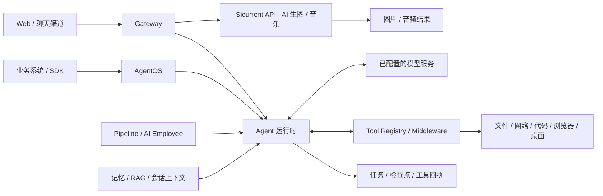

<h1 align="center">macs</h1>

<p align="center"><strong>简体中文</strong> | <a href="README.en.md">English</a></p>

<p align="center">
  <strong>多智能体协作系统 · 麦卡斯</strong><br>
  让 Agent 持续完成工作，并沉淀可复用的经验与流程
</p>

<p align="center">
  <a href="go.mod"></a>
  <a href="#系统架构"></a>
  <a href="#数据与部署"></a>
  <a href="LICENSE"></a>
</p>

<p align="center">
  <a href="#系统架构">系统架构</a> ·
  <a href="#界面与演示">界面演示</a> ·
  <a href="#核心优势">核心优势</a> ·
  <a href="#产品定位与比较">产品定位</a> ·
  <a href="#功能全景">功能全景</a> ·
  <a href="https://github.com/niqinggood/sicurrent-soft/releases/tag/downloads">下载编译版</a> ·
  <a href="#快速开始">快速开始</a> ·
  <a href="#从源码编译与运行">编译与运行</a> ·
  <a href="#记忆与遗忘">记忆与遗忘</a> ·
  <a href="#企业系统接入">企业系统接入</a> ·
  <a href="#核心代码导读">代码导读</a> ·
  <a href="#文档导航">文档</a>
</p>

---

## macs 是什么

**macs（Multi-Agent Collaboration System）是一套可自行部署的 AI Agent 工作系统。** 用户可以通过自然语言提出目标，让 Agent 获取资料、理解项目、调用工具、协作执行并交付文件，也可以把这些能力接入已有业务系统。

产品提供两种主要使用模式：

- **Agent 模式**：理解目标、规划任务、调用工具并组织多智能体协作，执行复杂工作和核验交付结果。
- **对话问答模式**：日常问答、内容撰写，以及通过 **Sicurrent API** 接入的 AI 生图、AI 音乐生成等创作能力。生图型号包括平台目录中的 Nano Banana、`gpt-image2` 等，具体以账号的可用模型列表为准。

系统以 Go 为主要开发语言，将 Web 界面和内置技能嵌入程序。同一套 Agent 工具和技能可以用于个人任务、专家团队和工作流，也可以通过 AgentOS 接入已有业务系统。

正式产品名是 **macs**，中文名为 **麦卡斯**，小名是 **openkitty**。现有 `openkitty.exe`、`openkitty-config.yaml`、`OPENKITTY_*` 等技术名称继续保留兼容。

| 使用方式 | 可以完成什么 |
| --- | --- |
| 个人助手 | 问答、资料整理、编程辅助、文件处理、知识检索和日常工作 |
| 项目协作 | 组织不同职责的 Agent，分工研究、编写、分析和核对 |
| 自动化工作台 | 处理文档模板、执行浏览器与桌面操作、复用成功流程 |
| 企业任务后端 | 由业务系统提交异步任务，获取状态、进度、结果及交付物 |

<p align="center">
  <a href="docs/images/showcase/overview.png"></a>
  <br><sub>macs 工作台 · V1.1.8 演示界面，点击查看原图</sub>
</p>

## 系统架构



| 概念 | 用来做什么 |
| --- | --- |
| Agent | 理解目标、判断下一步，调用工具完成工作并检查结果 |
| Tool | 执行一次具体操作，例如读取文件、搜索资料或运行测试 |
| Skill | 为 Agent 提供某类工作的知识、操作步骤和配套资源 |
| Pipeline | 把多步骤工作组织成可复用流程，明确每步输入、产出和检查要求，并保存执行进度 |
| AI Employee | 按业务岗位配置职责、技能和工作流，接收消息任务或按计划执行工作 |
| AgentOS | 让业务系统通过 API 调用 Agent 岗位，在后台执行任务、跟踪进度、获取结果，并支持中断恢复 |

源码入口：

```text
cmd/macs/main.go
  → internal/app.Main()
  → 应用装配与 Gateway
  → Agent 运行时
  → 工具注册、中间件和具体工具
  → 任务结果、会话与记忆持久化
```

目录导航：

| 路径 | 主要内容 |
| --- | --- |
| [`cmd/macs/`](cmd/macs/) | 程序入口与版本注入 |
| [`internal/app/`](internal/app/) | 应用装配、Gateway 与跨模块协调 |
| [`internal/agentloop/`](internal/agentloop/) | Agent 回合状态、租约与恢复 |
| [`internal/agentos/`](internal/agentos/) | AgentOS 协议、持久任务和领域模型 |
| [`internal/pipeline/`](internal/pipeline/) | 流程检查点与输入输出契约 |
| [`internal/memory/`](internal/memory/) | 长期记忆、召回、更正与遗忘 |
| [`internal/tools/`](internal/tools/) | 文件、网络、内容、开发、界面自动化等工具 |
| [`internal/toolregistry/`](internal/toolregistry/) | 工具发现、注册、筛选与执行 |
| [`pkg/`](pkg/) | 可复用的公共 Go 能力 |
| [`web/`](web/) | 无前端打包步骤的原生 Web 界面 |
| [`builtin/`](builtin/) / [`default-skills/`](default-skills/) | 内嵌技能与运行资源 |
| [`sdk/`](sdk/) | 外部系统接入客户端 |
| [`docs/`](docs/README.md) / [`scripts/`](scripts/README.md) | 长期文档、构建和验证入口 |
| [`testdata/`](testdata/) | 测试夹具与业务评测入口 |

根目录 `assets.go` 集中声明内嵌资源；业务逻辑按领域存放。开发导读见 [`internal/README.md`](internal/README.md) 和 [Go 模块化说明](docs/architecture/go-modularization.md)。

## 界面与演示

从专家团队分工、工作流编排到知识检索和 Word 交付，下面展示 macs 的具体操作界面。点击图片可查看原图，更多操作过程见[完整演示图集](docs/showcase.md)。

<table>
  <tr>
    <td width="50%" valign="top">
      <a href="docs/images/showcase/expert-teams.png"></a>
      <p><strong>多 Agent 专家团队</strong><br>按研究、编程、内容与审查等职责组织协作。</p>
    </td>
    <td width="50%" valign="top">
      <a href="docs/images/showcase/pipelines.png"></a>
      <p><strong>可复用的工作流</strong><br>把业务步骤组织成可配置、可跟踪的 Pipeline。</p>
    </td>
  </tr>
  <tr>
    <td width="50%" valign="top">
      <a href="docs/images/showcase/knowledge.png"></a>
      <p><strong>知识库与 RAG 问答</strong><br>从导入资料中检索答案，并展示相关来源。</p>
    </td>
    <td width="50%" valign="top">
      <a href="docs/images/showcase/document-output.png"></a>
      <p><strong>文档自动化与交付</strong><br>核对字段映射、预览 Word 结果并下载生成文件。</p>
    </td>
  </tr>
</table>

[查看全部 8 张演示截图 →](docs/showcase.md) · [English gallery](docs/showcase.en.md)

## 核心优势

**macs 将自然语言任务、真实工具执行、可恢复流程、结果验收和经验复用组织在同一套可自行部署的 Agent 系统中。** 编程、联网和文档处理是这套系统完成工作的具体手段。

### 1. 从个人任务到团队流程和企业系统

在 Web 中验证过的工具、技能和处理方法，可以继续用于专家团队和 Pipeline，也可以通过 AgentOS 提供给业务系统。例如，一套报告生成方法既能由个人在工作台使用，也能配置为业务岗位，由已有系统提交资料、跟踪处理进度并获取报告。

### 2. 让长任务有状态、能恢复、可核对

业务系统可以查看任务状态和阶段进度，在执行中补充要求或取消任务。macs 保存任务状态、检查点和工具执行记录，为中断恢复和结果核对提供依据；Pipeline 还可以检查每步输入与产出，并将不符合要求的结果退回重做。恢复遵循模型和工具的执行边界，写入结果不确定时停止自动重放。

### 3. 让 Agent 判断问题，让固定步骤按规则执行

Agent 负责理解资料、判断问题和探索解决方法。经过核对的固定步骤可以交给工作流或专用工具执行。例如，Agent 提出 Word 模板的字段映射，DOCX 引擎按映射填写文档、检查结构和遗漏；确认可用后，保存方案，后续批次更换业务数据继续生成。

### 4. 让偏好、资料和成功做法用于后续工作

长期记忆保存适用的偏好与经验，RAG 提供资料检索，Skills 组织操作方法，模板方案保存映射规则。`workflow_learner` 还能将成功的 `computer` 操作会话编译成带输入参数和成功断言的复用流程。记忆可以更正与遗忘；流程复用需要核验，当前并非所有任务都会自动学成技能。

### 5. 可以自己部署，也能按业务改造

Go 主程序内嵌原生 Web 与内置技能，本地可使用 SQLite，模型、工具和业务逻辑可以按许可证及接口扩展。用户可从个人电脑起步，再按需要部署为服务。浏览器、Office/PDF 转换和外部平台等能力仍需相应依赖与配置。

这些是已有架构与实现支持的产品特点；实际完成质量、耗时和成本需要结合模型与具体任务评测。

## 产品定位与比较

macs 更适合希望**自己部署、按业务改造，并把 Agent 纳入持续工作流程**的个人与团队。比较时应关注工作方式、集成成本和任务结果。

| 产品 | 官方资料强调的方向 | macs 值得关注的取向 |
| --- | --- | --- |
| [OpenClaw](https://github.com/openclaw/openclaw) | 自行部署的助手、消息渠道、Gateway 与扩展生态 | 将业务 Pipeline、持久任务 API 和文档模板交付集成在同一产品中 |
| [WorkBuddy](https://cloud.tencent.com/product/workbuddy) | 办公工作台、专家协作及腾讯生态连接 | 提供可按许可审查与改造的 Go 实现、嵌入式 Web 和自行装配的业务能力 |
| [Hermes Agent](https://github.com/NousResearch/hermes-agent) | 记忆、经验学习和技能积累 | 同时强调业务流程契约、模板方案和带断言的界面流程复用 |
| [Codex](https://developers.openai.com/blog/codex-as-a-platform) | Agent 执行环境，以及 CLI、SDK、app-server 等产品集成方式 | 集成通用工作台、文档引擎、记忆、渠道与业务编排，供具体业务组合使用 |

其他产品也具备记忆、工具、协作或企业接入能力。上表是产品取向比较，不能据此推断 macs 的编码成功率、速度、成本或记忆效果领先。核对日期：2026-10-16。详细依据与边界见[产品定位与比较](docs/product-positioning.md)（[English](docs/product-positioning.en.md)）。

## 典型工作场景

下面说明这些机制如何用于具体工作。实际效果取决于所选模型、任务输入和运行环境。

### 1. 编程：形成理解、修改、验证与交付的闭环

Agent 可以从项目结构和仓库约定入手，结合代码检索、LSP、AST 和依赖信息定位问题，进行精确编辑或跨文件修改，再运行测试、构建、静态检查及行为验收。

- **理解已有项目**：读取项目说明、查找符号、分析定义与引用，利用仓库上下文确定修改范围。
- **执行工程操作**：编辑文件、处理多文件重构、运行命令，并在需要时使用 Git/worktree 等工程工具。
- **沿用真实工程环境**：使用部署环境中已有的编译器、依赖和项目资料，便于在现有代码库中持续工作。
- **保留验证证据**：`goal_verify` 返回 `PASS / FAIL / PARTIAL`，分别表达选定检查通过、失败和证据不足；验收可以包含可执行的行为断言。
- **把编码变成后台任务**：通过 AgentOS 提交代码任务，在上层应用中查询进度、补充要求、取消执行并读取结果。

适合的场景包括：修复一个已有项目的问题、修改接口后验证兼容性、批量调整代码、生成测试，以及为 IDE 或内部研发平台提供后台 Agent。

源码与机制：[编程工具](internal/tools/development/) · [目标验收](docs/architecture/goal-verification.md) · [运行可靠性](docs/architecture/runtime-reliability.md)

### 2. 网络：搜索、正文读取、平台访问与浏览器协同

macs 将信息发现和后续处理连接起来。Agent 可以先检索资料，再读取原文、查看页面、提取结构化内容，并将结果继续用于知识检索、数据分析、报告编写或业务任务。

- **多种获取方式配合**：复用搜索、网页抓取、平台读取和浏览器工具，根据页面类型与可用后端选择路径。
- **平台能力按需接入**：`agent_reach` 提供搜索、读取、热点和转录等只读路由，复用已配置的 CLI、API 或浏览器后端，并保留原生搜索与读取回退。
- **动态页面可进入真实浏览器**：需要交互或已有登录状态的流程，可以结合浏览器与 `computer` 继续操作和验证。
- **与企业网络环境衔接**：在配置允许的范围内连接内部 API、业务页面和自有服务，将信息获取与后续执行放在同一任务中。

适合的场景包括：调研一个主题并整理来源、跟踪行业信息、阅读网页与平台内容、获取业务资料后生成文档。平台登录、外部服务和页面可访问性仍以实际环境为准。

源码与机制：[网络工具](internal/tools/network/) · [Agent Reach 路由](internal/tools/network/agent_reach.go) · [界面自动化](docs/architecture/computer-use.md)

### 3. 办公：围绕现有模板和交付要求处理文档

macs 支持把输入资料推进为实际文件交付。除了内容提取与报告生成，还提供面向已有 Word 模板的结构化填写能力。

- 检查模板中的字段、内容控件、书签和表格结构。
- 使用声明式字段映射、稳定单元格地址和重复行配置填写文档。
- 在生成前核对映射，在生成后检查遗漏和结构，并按需要预览与视觉核验。
- 按模板结构指纹保存可复用方案，后续批次更换业务数据继续生成。

适合的场景包括：企业固定格式报告、合同资料、记录表、批量模板填报和汇报材料。模板适配主要围绕文档结构和数据契约展开，便于用于不同业务模板。

使用与机制：[用户手册](docs/macs-user-manual.md) · [文档自动化](docs/architecture/document-automation.md)

### 4. 自动化：将成功的界面操作沉淀为可复用技能

统一的 `computer` 入口复用浏览器和桌面后端，以“观察—操作—验证”的方式完成界面任务。`workflow_learner` 可以从成功的操作会话中生成参数化流程，保留输入槽与成功断言，并支持换一组输入重放和评测。

这让一次实际操作经验有机会转化为后续可复用的业务流程。页面布局、定位方式或桌面环境变化后，仍需重新观察并核验流程。

### 5. 记忆：积累偏好和经验，也能更正与遗忘

Agent 可以结合当前任务，选择性调用长期偏好、项目约定和相关历史参考，减少重复说明。用户能够查看来源、编辑内容、调整召回和执行遗忘；明确的长期要求与待核对内容有不同处理方式。

记忆管理的价值在于让长期协作更加连贯，同时保留整理和纠正的入口。详见[记忆与遗忘](#记忆与遗忘)。

### 6. 集成：从个人工作流延伸到企业任务服务

个人可以通过 Web 与聊天渠道使用；企业可以通过 AgentOS、SDK、Pipeline、AI Employee、MCP 和工具扩展对接已有系统。自然语言任务、文档处理和界面自动化可以组合为业务流程。

对于长任务，系统提供持久化状态、幂等提交、事件流、取消和恢复机制，便于上层应用把 Agent 执行纳入自己的业务生命周期。

## 功能全景

| 能力 | 可以完成什么 |
| --- | --- |
| 智能对话与模型配置 | 进行问答或提交 Agent 任务，查看历史、添加附件，并按需配置云端或本地模型 |
| 通用 Agent 执行 | 理解目标、规划步骤、调用工具，检查结果并交付文件，支持超时控制与取消 |
| 编程与代码智能 | 检索和分析代码，进行跨文件修改与重构，运行测试和构建，并核验完成情况 |
| 网络与研究 | 搜索并读取网页和平台内容，整理资料、核对来源，继续用于研究或报告 |
| 记忆与遗忘 | 保存长期偏好和项目约定，按任务召回相关历史参考，支持查看、更正和遗忘 |
| 知识库与 RAG | 导入资料后按关键词或语义检索，为回答提供相关片段与来源，可按配置启用增强检索和重排 |
| 文档与文件 | 提取文件内容、填写 Word 模板、映射字段和复制表格行，生成报告与办公文件 |
| 浏览器与桌面 | 观察页面或桌面、操作控件并截图核验，将成功操作整理为可复用流程 |
| 多智能体与专家团队 | 按职责组织多个 Agent，顺序或并行处理子任务，并复用团队模板 |
| Pipeline | 编排多步骤工作，配置每步输入与产出、分支条件和审批节点，并保存检查点以支持恢复 |
| AI Employee | 配置岗位职责、技能和工作流，按消息或定时计划派发任务 |
| 多渠道接入 | 按渠道配置，从飞书、微信、钉钉、企业微信、QQ、Telegram 和邮件等入口使用 Agent |
| 多模态与媒体 | 理解图片、处理语音；通过 Sicurrent API 生成图片（Nano Banana、gpt-image2 等）和音乐；按模型与服务配置使用视频入口 |
| MCP 扩展 | 连接外部 MCP 服务，将其提供的工具和资料用于任务 |
| Skills | 安装或启用领域技能，复用知识、操作步骤和配套资源 |
| Hooks | 在会话、模型调用和工具执行等节点接入自定义处理逻辑 |
| AgentOS 与 SDK | 让业务系统提交后台任务、跟踪进度、补充要求或取消执行，并获取结果与交付文件 |

具体工具、渠道和媒体能力依赖对应服务、账号或本地运行时；安装主程序并不代表所有扩展后端已经配置完成。

### AI 生图与音乐：Sicurrent API 接入

Web 中的 **AI 生图和 AI 音乐生成，是 macs 通过 Sicurrent API 接入的平台创作能力**。macs 提供描述与参考图输入、参数选择、任务提交、进度查询，以及图片预览、音频试听和下载；Sicurrent 平台负责生成模型调用、生成任务和账号结算。

使用时登录 Sicurrent 账号，从平台目录选择生图或音乐模型，再提交画面描述、曲风要求或歌词。图片可选比例和参考图，音乐可选歌曲或纯音乐。Nano Banana、`gpt-image2` 等生图型号，以及音乐型号、价格和可用性，均以平台当前目录和账号可用列表为准；实际调用按 Sicurrent 平台规则结算。

[查看使用说明](docs/macs-user-manual.md) · [查看 API 接入实现](internal/auth/platform_media.go)

## 快速开始

### 直接下载编译版

**不需要自行编译时，直接前往 [macs 编译版下载页](https://github.com/niqinggood/sicurrent-soft/releases/tag/downloads)。** 页面提供以下 macs 2.0.0 预览构建的原始可执行程序和 SHA-256 校验清单，无需安装 Go 或解压。下载时请认准 `macs` 名称，页面中也保留其他软件和历史版本。

| 系统与处理器 | 下载文件 |
| --- | --- |
| Windows x64 | [macs-2.0.0-win.exe](https://github.com/niqinggood/sicurrent-soft/releases/download/downloads/macs-2.0.0-win.exe) |
| Linux x64 | [macs-2.0.0-linux-amd64](https://github.com/niqinggood/sicurrent-soft/releases/download/downloads/macs-2.0.0-linux-amd64) |
| Linux ARM64 | [macs-2.0.0-linux-arm64](https://github.com/niqinggood/sicurrent-soft/releases/download/downloads/macs-2.0.0-linux-arm64) |
| macOS Intel | [macs-2.0.0-mac-intel](https://github.com/niqinggood/sicurrent-soft/releases/download/downloads/macs-2.0.0-mac-intel) |
| macOS Apple Silicon（M 系列） | [macs-2.0.0-mac-apple](https://github.com/niqinggood/sicurrent-soft/releases/download/downloads/macs-2.0.0-mac-apple) |

将程序放入独立目录，按对应系统启动。程序会查找项目和用户配置；首次运行找不到配置时，会从内嵌模板在用户目录的 `.openkitty/` 中创建 `openkitty-config.yaml`。已有配置时继续使用原文件。

```powershell
# Windows / PowerShell
.\macs-2.0.0-win.exe --path . --port 8090
```

```bash
# Linux x64
chmod +x ./macs-2.0.0-linux-amd64
./macs-2.0.0-linux-amd64 --path . --port 8090
```

```bash
# macOS Apple Silicon（Intel 将程序名换为 macs-2.0.0-mac-intel）
chmod +x ./macs-2.0.0-mac-apple
./macs-2.0.0-mac-apple --path . --port 8090
```

Linux ARM64 将示例中的程序名换为 `macs-2.0.0-linux-arm64`。打开 `http://127.0.0.1:8090/web/`，以终端报告的实际地址为准，再按下文配置模型。

Windows 也可以双击 exe 启动，以启动日志中的地址为准。`--path .` 表示把当前目录作为工作目录；处理自己的项目时，可将 `.` 换为项目路径，路径含空格时用双引号包住。终端启动时按 `Ctrl+C` 停止服务；若 8090 已被占用，可将 `--port 8090` 改为其他空闲端口。

### 下载后怎么用

1. **打开工作台**：启动程序，在浏览器访问日志中的 `/web/` 地址。
2. **配置模型**：进入 **设置 → 模型配置**，填写模型服务地址、模型名称和 API Key，保存后为助手选择模型。已有兼容接口或本地模型服务也可接入，详见下方配置示例。
3. **选择工作方式**：日常提问使用对话问答模式；需要读写文件、编程、联网或完成多步骤任务时，选择 Agent 模式，并指定正确的工作目录。
4. **给出目标和交付要求**：例如“阅读当前目录的资料，生成一份 Markdown 摘要，列出结论、引用文件和待确认问题”。执行后在对话中查看结果与交付文件。
5. **按需使用扩展能力**：通过 `@Skill名` 使用指定技能，或配置专家团队、知识库和工作流。AI 生图、AI 音乐需要配置 Sicurrent 平台账号及可用服务；仅启动程序不会自动获得这些服务。

首次使用建议先完成一次简单问答，再尝试一个范围明确的 Agent 任务。[完整使用手册](docs/macs-user-manual.md) 包含模型配置、记忆管理、文档自动化和备份恢复步骤。

发布页也保留包含配置模板、构建记录和完整许可材料的压缩包，供需要时下载；使用前请阅读许可说明。预览版的构建与验证范围见发布说明，Linux 和 macOS 程序由交叉编译生成，尚未在对应系统运行验证。浏览器、模型服务和 Office/PDF 转换等外部依赖仍按所用功能配置。

### 1. 获取源码

需要 Git 和 **Go 1.26**。Web 界面是原生 HTML/CSS/JavaScript，无需先运行前端打包命令。

```bash
git clone https://github.com/niqinggood/macs.git
cd macs
```

### 2. 复制配置并启动

首次运行时复制配置；已有自己的配置文件时，保留原文件并直接启动。

Windows / PowerShell：

```powershell
Copy-Item .\openkitty-config.template.yaml .\openkitty-config.yaml
go run ./cmd/macs --config .\openkitty-config.yaml --path . --port 8090
```

Linux / macOS：

```bash
cp openkitty-config.template.yaml openkitty-config.yaml
go run ./cmd/macs --config ./openkitty-config.yaml --path . --port 8090
```

`cmd/macs` 是正式程序入口；`cmd/openkitty` 保留为旧命令的兼容入口。配置文件名、数据目录和环境变量继续沿用现有兼容名称。

打开 `http://127.0.0.1:8090/web/`，以终端输出的实际地址为准。模板默认监听 `127.0.0.1:8080`，上述命令通过 `--port` 指定 8090。已有配置继续使用自己的协议、监听设置和认证方式。

Web 顶部提供 **中文 / EN** 切换。部分扩展页面和较长帮助说明仍未完整英译。

### 3. 配置一个可用模型

在 Web 设置中配置模型服务、模型名称与凭据，再为助手选择模型或沿用当前默认模型。已有 Ollama、vLLM 或兼容接口服务时，可按其实际地址接入；本地模型服务需要自行安装、启动并准备模型。

模型密钥支持环境变量引用。例如，在现有 `model_cfg` 中配置一个兼容接口模型：

```yaml
default_model: my-model
model_cfg:
  my-model:
    type: openai
    base_url: https://your-model-provider.example/v1
    model_name: REPLACE_WITH_MODEL_NAME
    api_key_env: MACS_MODEL_API_KEY
    max_tokens: 4096
```

使用环境变量时，先在启动终端设置密钥，再启动或重启 macs：

```powershell
# Windows / PowerShell
$env:MACS_MODEL_API_KEY = "REPLACE_WITH_YOUR_MODEL_API_KEY"
```

```bash
# Linux / macOS
export MACS_MODEL_API_KEY='REPLACE_WITH_YOUR_MODEL_API_KEY'
```

把示例地址、模型名和密钥替换为自己的配置；修改已有同名配置段，避免重复追加 YAML 顶层字段。助手的 `model` 留空时可继承当前默认文字模型。已经启动的任务保留提交时的模型设置。

详细说明：[模型配置与使用手册](docs/macs-user-manual.md) · [配置模板](openkitty-config.template.yaml)

### 4. 提交第一个任务

可以从输入与交付要求都明确的小任务开始：

```text
阅读指定目录中的资料，整理一份 Markdown 摘要。
列出主要结论、引用的文件，以及仍需确认的问题。
```

需要调用工具、使用 Agent 记忆或执行多步骤工作时，使用 Agent 模式，并启用任务所需能力。简单问答与直接媒体生成使用各自的处理路径。

### 从源码编译与运行

以下命令在项目根目录（包含 `go.mod` 的目录）执行，需要 **Go 1.26**。首次构建会自动下载 Go 模块依赖。首次运行前，按上文复制配置模板；已有配置文件时继续使用原文件。

Windows / PowerShell：

```powershell
go run ./cmd/releaseguard
go build -buildvcs=false -trimpath -o macs.exe ./cmd/macs
.\macs.exe --config .\openkitty-config.yaml --path . --port 8090
```

Linux / macOS：

```bash
go run ./cmd/releaseguard
go build -buildvcs=false -trimpath -o macs ./cmd/macs
./macs --config ./openkitty-config.yaml --path . --port 8090
```

Windows 生成根目录的 `macs.exe`，Linux/macOS 生成根目录的 `macs`。`go build` 只编译，随后执行生成的程序才会启动服务；打开 `http://127.0.0.1:8090/web/` 使用。

Web 界面和内置 Skills 已编入程序，无需运行 `npm build`。修改 `web/`、`builtin/` 或其他内嵌资源后，需重新编译；配置文件和运行数据仍保存在程序外部。

使用编译好的程序无需安装 Go。正式平台打包、版本注入和交叉编译见 [构建脚本说明](scripts/README.md)，现有打包脚本的产物保留 `openkitty` 兼容文件名。

#### Windows 批处理编译：abuild_windows.bat

在源码根目录打开 PowerShell。先安装 Windows 图标与版本信息生成工具 `go-winres`，再从 [UPX 官方发布页](https://github.com/upx/upx/releases) 下载 Windows x64 版本，将解压后的 `upx.exe` 放入 PATH，或放在源码根目录。UPX 用来压缩可执行程序，不要将它提交进源码仓库。

```powershell
go install github.com/tc-hib/go-winres@latest
.\abuild_windows.bat 2.0.0 require
.\openKitty-2.0.0-win.exe --path . --port 8090
```

`require` 表示必须找到 UPX，并在压缩和完整性检查通过后交付 exe；缺少 UPX 或压缩失败会返回错误。双击 `abuild_windows.bat` 会提示输入版本，回车默认 `2.0.0`，使用 `auto` 模式：找到 UPX 就压缩，找不到则明确提示并生成未压缩程序。需要保留未压缩程序时使用 `off`。

| 命令 | 用途与产物 |
| --- | --- |
| `.\abuild_windows.bat 2.0.0 require` | Windows x64；根目录 `openKitty.exe`、`openKitty-2.0.0-win.exe`；有 RAR 工具时另生成压缩包 |
| `.\abuild_windows.bat 2.0.0 off` | Windows x64，不使用 UPX |
| `.\scripts\build\build_linux.bat 2.0.0 amd64` | Linux x64；`dist/openkitty_linux_amd64` |
| `.\scripts\build\build_linux.bat 2.0.0 arm64` | Linux ARM64；`dist/openkitty_linux_arm64` |
| `.\scripts\build\build_mac.bat 2.0.0 fast` | 同时生成 Intel 和 Apple Silicon 两个 macOS 程序 |

UPX 不在上述位置时，可先设置 `$env:MACS_UPX = "C:\Tools\upx\upx.exe"` 指向自己的工具路径。各脚本支持 `--help`。这些命令在 Windows 上运行；Linux/macOS 产物需复制到对应系统，执行 `chmod +x` 后使用。macOS 的 `release` 模式还会执行完整质量门，失败即停止；`fast` 只用于本地构建，仍执行发布凭据检查。

脚本会剥离调试信息并注入版本、UTC 构建日期；Windows 是否经过 UPX 压缩会明显影响 exe 大小。直接使用前面的普通 `go build` 命令不会执行 UPX 压缩。上述单二进制程序与 Electron 桌面壳的打包方式不同，后者见[脚本说明](scripts/README.md)。

Windows 的可执行程序支持双击启动。当前 macOS 与 Linux 构建为命令行程序，通常需先赋予执行权限并从终端启动；三平台统一的桌面应用打包仍待完善。

## 记忆与遗忘

记忆总开关默认开启，可在 Web **设置 → 工作与记忆 → Agent 记忆** 中修改，也可以通过配置控制：

```yaml
memory_config:
  enabled: true
```

各助手还会使用自己的 `has_memory` 设置。保存设置后对新任务生效；简单问答不经过 Agent 长期记忆召回链。

| 环节 | 当前机制 |
| --- | --- |
| 保存 | 支持明确的长期要求、用户维护的偏好与约定，以及运行中记录的相关经验和摘要 |
| 召回 | 结合当前问题、适用范围、有效状态和上下文预算选择内容；语义召回需要配置对应 embedding 后端 |
| 整理 | 管理页提供来源查看、新增、编辑、更正、常驻及召回控制等入口 |
| 遗忘 | 已遗忘的统一记忆条目退出自动召回，并保留必要的撤回保护，避免旧兼容内容直接复活 |

例如，可以提出“记住：今后的项目报告默认使用中文，并附参考来源”，也可以在管理页修改或遗忘已有要求。当前请求中的明确要求优先于长期默认。

长期条目、历史消息、摘要、学习笔记和知识库资料属于不同来源；整理时可以分别查看和处理。输入来源记录能够帮助追溯参考内容，但不能证明模型最终采用了某一条记忆，也不代表遗忘一条记录会自动删除全部派生资料。

详细机制：[记忆服务](docs/architecture/memory-service.md) · [当前记忆系统说明](docs/architecture/memory-system-summary.md)

## 企业系统接入

**AgentOS 是 macs 面向业务系统的 Agent 任务服务。** 已有系统可以把资料审查、报告生成或代码维护交给配置好的 Agent 岗位，由 macs 在后台处理，再查询进度、补充要求或获取结果与文件，无需一直保持最初的请求连接。

接入使用异步任务 API：新任务接收后返回 `202 + task_id + links`，业务系统通过返回的链接查询状态、订阅进度并获取结果。

```text
业务系统提交任务
    → 返回 task_id 和查询链接
    → macs 排队、执行模型与工具调用
    → 业务系统查询快照或订阅任务 SSE
    → 获取最终状态、结果和交付物
```

主要支持：

- 将 Agent 配置为可调用的业务岗位，明确职责、可用工具及输入输出要求。
- 按调用方身份确定可用岗位和数据归属，供不同业务服务接入。
- 使用幂等键重试提交，避免网络重试产生重复任务。
- 查看执行状态和阶段，在运行中补充要求或取消任务。
- 保存任务状态、检查点和工具执行记录，在可恢复的执行节点继续任务。
- 使用 Go/Python SDK，或直接通过 HTTP 与 SSE 接入。

下面沿用 [AgentOS 入门](docs/agentos-quickstart.md) 中的独立监听端口 `8081`、岗位 `document-assistant` 和业务服务凭据配置；这些内容需要先在自己的服务中配置。

```bash
export MACS_SERVICE_TOKEN='REPLACE_WITH_YOUR_SERVICE_TOKEN'

cat > task.json <<'JSON'
{
  "role_id": "document-assistant",
  "message": "把以下内容整理为工作摘要：今天完成了需求讨论和接口设计。"
}
JSON

curl -i --max-time 30 -X POST http://127.0.0.1:8081/api/v1/agent/tasks \
  -H "Authorization: Bearer $MACS_SERVICE_TOKEN" \
  -H 'Content-Type: application/json; charset=utf-8' \
  -H 'Idempotency-Key: summary-example-001' \
  --data-binary @task.json
```

提交成功表示任务已接收；继续使用返回的 `links.self` 获取最终快照，或使用 `links.events` 订阅进度。同内容重试复用原幂等键，新任务使用新键。

最终状态以持久任务快照为准。SSE 只提供有界的近期重放；收到 `replay_reset` 后应重新查询快照。恢复发生在模型或工具的稳定边界，结果不确定的写操作会停止自动重放。

接入文档：[部署与调用入门](docs/agentos-quickstart.md) · [API 契约](docs/agent-os-api.md) · [OpenAPI](docs/openapi-agentos.yaml) · [SDK](sdk/README.md) · [Python SDK](sdk/python/README.md)

## 核心代码导读

建议从一次真实的 Agent 对话开始阅读，再跟进工具执行、任务恢复和经验沉淀：

```text
cmd/macs/main.go：main
  → internal/app/mac.go：Main → run → NewBot → ClawBot.Run
  → POST /api/chat
  → internal/app/gateway.go：handleChat → processTaskWithSession
  → internal/app/mac.go：LLMAgent.Generate
  → Tool Registry / Middleware → Tool.Execute → 工具回执
  → 继续推理或校验结果 → 保存任务、会话及适用的记忆 → 返回结果
```

| 阅读目标 | 代码入口 | 重点看什么 |
| --- | --- | --- |
| 模型怎样持续调用工具 | [`LLMAgent.Generate`](internal/app/mac.go)、[`agentloop`](internal/agentloop/) | 回合上下文、执行循环、取消与恢复边界 |
| 工具怎样被发现和执行 | [`toolcontract`](internal/toolcontract/tool.go)、[`Registry`](internal/toolregistry/registry.go)、[`Middleware`](internal/middleware/) | 参数 Schema、按需激活、执行策略与结果回执 |
| 长任务怎样接入业务系统 | [`AgentOS 宿主`](internal/app/agent_os_api.go)、[`AgentOS 模型`](internal/agentos/)、[`会话检查点`](internal/session/checkpoint.go) | 异步提交、持久快照、租约、幂等及恢复 |
| 工作如何变得可重复 | [`Pipeline`](internal/pipeline/)、[`DOCX 方案`](internal/tools/content/docx_template_profile.go)、[`流程编译器`](internal/workflowlearn/compiler.go) | 输入输出契约、模板指纹、参数化与成功断言 |
| 经验怎样保留与调用 | [`memory`](internal/memory/)、[`session`](internal/session/)、[`conversation`](internal/conversation/) | 长期事实、执行历史与当前上下文的不同职责 |

这条调用链描述 Agent 模式；简单问答和直接媒体生成使用各自路径。根目录 [`assets.go`](assets.go) 只嵌入资源，业务装配在 `internal/app/`，可独立的领域规则在对应 `internal/*` 包中；模块化迁移仍在进行。

完整阅读路线、关键实现和修改示例见[核心代码导读](docs/architecture/code-walkthrough.md)（[English](docs/architecture/code-walkthrough.en.md)）；更细的请求链路见 [`internal/README.md`](internal/README.md)。

## 数据与部署

- **本地持久化**：未配置 MySQL 时默认使用 SQLite，无需先部署数据库服务；默认数据库随工作目录保存在 `.openkitty/` 下。
- **服务器部署**：可按配置使用 MySQL；提供 Docker Compose、服务器常驻与 Kubernetes 的相关配置和说明。
- **文件交付**：生成文档、附件、知识资料及部分兼容内容保存在文件系统，备份时同时保存工作目录和配置。
- **平台与依赖**：支持 Windows、Linux 和 macOS 对应构建；浏览器、桌面、OCR、Office/PDF 转换及部分外部工具需要相应运行环境。
- **扩展连接**：按需要配置 MCP、模型服务、聊天渠道和外部 CLI；账号及供应商可用性影响对应能力。

主程序为 Go 单二进制，但完整任务所需的外部工具仍需按实际使用场景准备。Docker 构建会执行质量门，与源码测试状态保持关联。

部署说明：[AgentOS 部署](docs/agentos-quickstart.md) · [Kubernetes](docs/kubernetes.md) · [Dockerfile](Dockerfile) · [Docker Compose](docker-compose.yml)

## 开发与验证

从仓库根目录执行：

```bash
# 发布输入检查与主程序构建
go run ./cmd/releaseguard
go build -buildvcs=false -trimpath ./cmd/macs

# 对修改范围执行聚焦测试
go test ./internal/agentos -count=1

# 完整测试
go test ./... -count=1
```

与 CI 一致的完整质量门：

```powershell
# Windows
.\scripts\quality_gate.ps1
```

```bash
# Linux / macOS
bash scripts/quality_gate.sh
```

修改原生前端脚本后，至少检查改动文件的语法：

```bash
node --check web/app.js
node --check web/chat.js
```

**当前仓库仍处于模块化迁移中。** 部分旧测试存在包边界、导入环和旧符号引用等已知问题，完整测试尚非绿色基线；具体背景见[模块化与测试状态](docs/architecture/go-modularization.md#当前验证限制)。主程序构建、聚焦测试和真实业务任务验收应分别记录，不互相代替。

代码变更需保留现有工作区与用户数据，遵守包边界，并附上实际执行过的验证结果。功能问题、缺少依赖和未执行的检查应在报告中明确说明。

贡献前请阅读 [贡献说明](CONTRIBUTING.md)。业务评测入口见 [能力评估方案](docs/engineering/agent-capability-evaluation-plan.md) 和 [重复评测说明](testdata/blackbox/AGENT_BASELINE.md)。

## 文档导航

| 想了解什么 | 文档 |
| --- | --- |
| 从启动到日常使用 | [macs 使用手册](docs/macs-user-manual.md) |
| English project introduction | [English README](README.en.md) |
| 产品优势与其他系统的比较 | [产品定位与比较](docs/product-positioning.md) / [English](docs/product-positioning.en.md) |
| 全部文档入口 | [文档导航](docs/README.md) |
| 企业系统怎样接入 | [AgentOS 入门](docs/agentos-quickstart.md)、[API 说明](docs/agent-os-api.md) |
| 记忆怎样保存、调用和遗忘 | [记忆服务](docs/architecture/memory-service.md)、[系统总结](docs/architecture/memory-system-summary.md) |
| Word 模板和批量文档 | [文档自动化](docs/architecture/document-automation.md) |
| 浏览器、桌面与流程复用 | [统一界面自动化](docs/architecture/computer-use.md) |
| 编程任务怎样验收 | [目标验收](docs/architecture/goal-verification.md) |
| 多步骤工作流 | [Pipeline 指南](docs/architecture/PIPELINE_GUIDE.md) |
| 专家团队怎样配置 | [项目专家团队](docs/architecture/team-templates.md) |
| 任务恢复与运行机制 | [运行可靠性](docs/architecture/runtime-reliability.md) |
| 如何理解和修改源码 | [核心代码导读](docs/architecture/code-walkthrough.md) / [English](docs/architecture/code-walkthrough.en.md)、[完整请求链路](internal/README.md)、[模块边界](docs/architecture/go-modularization.md) |
| 如何构建和验证 | [脚本导航](scripts/README.md) |

## 许可与贡献

macs 当前采用 **MACS Source Available License 1.0**，属于源码可见许可。个人非商业使用、教学及非商业研究、评估，以及符合许可证定义的小型企业内部使用，按许可证条款获得相应授权。

其他生产商用、向第三方提供托管服务、再分发、OEM 和白标等使用，需要按条款取得对应商业授权。第三方组件继续适用其各自的许可证。

- [完整许可证](LICENSE)
- [商业授权说明](COMMERCIAL-LICENSE.md)
- [版权与第三方声明](NOTICE)
- [第三方来源、许可文本及待核对事项](THIRD-PARTY-NOTICES.md)
- [贡献说明](CONTRIBUTING.md)
- [商标规则](TRADEMARKS.md)与[品牌规范](BRANDING.md)

问题反馈和功能建议可通过本仓库的 [Issues](https://github.com/niqinggood/macs/issues) 提交。提交问题时请附版本、环境、复现步骤和脱敏后的日志。
