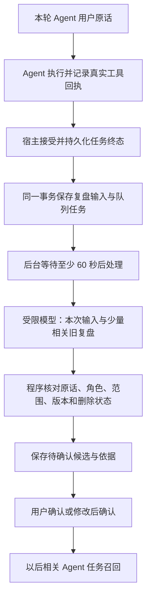

# macs Agent 记忆逻辑审阅材料

核对日期：2026-10-14。本文按当前 Go、Web 代码整理，供审阅实现逻辑；目标方案见 [完整升级方案](memory-system-upgrade-plan.md)，运行合同见 [统一记忆服务](memory-service.md)。

本机数据库的实际数量、差异和核验时间另放在 `.local/memory-review/`，不把运行时数据写进产品规范。本文没有修改或自动启用历史资料。

## 1. 先统一“记忆”的意思

用户所说的记忆，是**过去的信息在以后相关的 Agent 任务中能够被参考，并且用户能知道参考了什么、能够纠正。**

当前系统有几种不同内容，不能用一个“全部记忆数量”混算：

| 内容 | 例子 | 当前作用 |
| --- | --- | --- |
| 用户明确保存的要求 | “以后给客户甲报价，默认用 Excel。” | 保存为生效条目，相关 Agent 任务可召回 |
| 从任务归纳的候选 | “客户甲的报告可能更适合一页摘要。” | 等用户确认；确认前不自动加入普通 Agent 提示词 |
| 历史任务与工具记录 | 某次浏览器操作失败，另一种操作成功 | 保留事情经过；部分合法记录可按问题选作参考，不自动证明通用方法有效 |
| 工具统计 | 某工具调用、成功、失败次数 | 描述调用情况；不能当成用户偏好或解决办法 |
| 项目说明与知识资料 | AGENTS.md、产品手册、已有学习资料 | 按原指令加载或知识检索链读取，保留各自权限 |
| 当前对话上下文 | 这次对话之前的几条消息 | 会话系统维护，不单独罗列成一批长期记忆 |

`memory_entries` 是整理后的可管理条目集合，**不是所有历史信息的总和**。它为空，不代表聊天、项目说明、工具记录也都为空；但不能据此宣称已经自动学会了偏好和经验。

**产品边界：长期记忆只服务 Agent。简单问答使用当前对话历史，不读取长期记忆，不提交偏好提取或任务复盘。**

## 2. 当前实际有三条写入路径

### 2.1 用户明确要求，立即保存

```text
宿主冻结本轮原始用户输入
  → RecordExplicitUserTurn
  → 保守识别明确的“记住 / 以后默认”要求
  → CreateWithSource
  → memory_entries：active
```

这条路径不额外调用模型。当前解析限制为单行、最多 300 字符；一次性要求、明显引用、疑问、凭据及注入内容会被排除。它不是完整的自然语言理解器，复杂或指代不清的表达可能不保存。

保存内容包括：一句要求、来源类型、任务引用、用户原话、创建和更新时间。重复的相同键不覆盖人工修改，也不恢复已删除的相同键。

相关代码：[explicit_user_memory.go](../../internal/memory/explicit_user_memory.go)、[memory_explicit_user_evidence.go](../../internal/app/memory_explicit_user_evidence.go)。

### 2.2 Agent 调用记忆工具

`agent_memory` 和 durable `session_context` 复用同一个 Service。模型工具写入时，只有宿主冻结的用户指令与所写内容符合明确保存规则，才直接生效；推断和改写通常先成为候选。

这些工具不是另一个记忆数据库。查看、确认、更正、遗忘都要检查所有者、范围和必要的版本。隔离的内部执行不能借用个人记忆权限。

相关代码：[service_tool.go](../../internal/memory/service_tool.go)、[write_evidence.go](../../internal/memory/write_evidence.go)。

### 2.3 Agent 任务结束后，后台提取候选



Generate 只收集原始输入和回执，不直接授权新的后台学习。普通本机 Web 任务的终态、复盘输入和队列在同一数据库事务提交；未被接受的迟到结果不产生复盘。

失败任务也可以留下失败事实，但所有后台模型结论目前都先成为候选。**当前没有“自动证明修复办法有效，再自动转成成熟经验”的完整能力。**

后台读取的是 `memory_review_sources` 中的新复盘输入，不是自动遍历全部旧 `memory_events`。因此，安装新版本不会把以前所有任务自动归纳成新记忆。

相关代码：[reflection.go](../../internal/memory/reflection.go)、[reflection_store.go](../../internal/memory/reflection_store.go)、[memory_review_runtime.go](../../internal/app/memory_review_runtime.go)、[gateway.go](../../internal/app/gateway.go)。

## 3. 后台模型具体看什么

| 输入 | 用法与限制 |
| --- | --- |
| 本次原始用户输入 | 来自宿主冻结的请求，不采用拼入旧记忆的 prompt 反推用户声明 |
| 工具回执 | 当前最多 20 条，包含名称、成功失败与有界结果摘录 |
| 宿主终态和最终结果 | 提供任务背景；助手最终回答不能作为用户偏好原话 |
| 少量相关旧复盘 | 从同一所有者、工作区、Agent 最近 20 个旧输入中，按关键词相关性选取；总输入最多 12 个来源 |

实际发送 JSON 的长度最多 16000 字符，包含转义和元数据；必要时删去较旧来源、结果背景或部分回执。输出最多 2000 token、5 个候选。

每个候选必须给出：

1. 记住什么。
2. 什么时候使用。
3. 类型：偏好、事实或经验。
4. 本次提供的哪条来源、哪段确切原话或工具结果支持它。

模型不能传入任意数据库主键、用户、路径或表名。程序检查原话实际存在、证据角色和来源指纹。

推断习惯至少需要 3 个不同任务 ID 的用户依据，并仍然待确认。同一任务重试不增加支持次数。**这不是“已经证明用户习惯”的判断**：程序尚不能完整识别模板默认、被迫选择、跨新任务复制同一句话等情况。

当前做的是一次有界的提取/归纳调用；没有实现目标方案中独立、完整的第二阶段归纳器。也没有把相关的已确认 Entry、全部原始历史或工具累计统计一起提交给归纳器。

## 4. 工具成功、失败到底有没有统计

**有。原始明细和累计数字分开保存。**

| 层次 | 位置 | 内容 |
| --- | --- | --- |
| 原始执行明细 | 应用数据库 `memory_events.call_chain` | 工具/Skill 名称、成功失败、耗时及结果摘要，关联历史事件 |
| 累计工具统计 | 同一数据库 `tool_skill_stats` | 调用总数、成功数、失败数、成功率、总耗时、平均耗时、最近使用时间 |

默认 SQLite 文件是工作区 `.openkitty/openkitty.db`；使用 MySQL 时是配置的应用库中的同名表。统计表按 tenant、Agent、类型和名称查询，**没有完整的个人/工作区归属维度**。

当前写入顺序是：

```text
SaveMemoryEvent
  → 逐个读取 call_chain
  → updateToolSkillStat：读旧数字、加一、保存
  → 再插入 memory_events
```

这段旧实现存在可操作的问题：

- 统计与事件插入没有在一个事务中完成；事件插入失败，统计可能已加一。
- 事件重复保存之前没有统计幂等检查。
- 先读数字再写回，在并发下可能丢增量。
- 统计保存错误未返回。
- 缺少合法 bool 的 `success` 会落成 false，没有“结果未知”这一档。

因此累计数字不能直接当成绝对准确的账本。本机核验确实发现累计表与原始明细不同，差异记录在本地核验材料；目前不能断定全部差异只由某一个原因造成。

**工具返回成功率，也不是交付物合格率。** 例如写文件返回成功，文件内容仍可能填错，需要另看任务验收或用户反馈。

### 4.1 统计目前如何影响 Agent

旧 `GetMemoryContextForTenant` 会把部分低成功率工具显示为“需谨慎”、部分高成功率工具显示为“效果较好”。这是非 Web 兼容记忆上下文的一部分。

普通 Web Agent 走独立来源适配和 Service.Recall，**当前不会直接把整张累计统计表拼进 prompt，也没有把累计成功率统一接到工具选择策略。**

管理窗口的“工具使用数量”来自经过归属核实的近期事件调用链，并不是 `tool_skill_stats` 全表合计。两种数字不能混作同一统计口径。

相关代码：[store.go](../../internal/memory/store.go)、[memory_runtime.go](../../internal/app/memory_runtime.go)、[memory_management_catalog.go](../../internal/app/memory_management_catalog.go)。

## 5. 当前话题与历史话题，怎样判断相似

目前有三条不同的检索路径，不能混成一个“相似度百分比”。

| 路径 | 怎样查 | 是否保存每次结果 |
| --- | --- | --- |
| 旧历史检索 `SearchMemoryHybridForTenant` | FTS、中文关键词补充、可选向量；按 RRF 融合排序 | 匹配列表和分数主要在该次调用的内存中，没有长期话题相似度矩阵 |
| 当前统一 `Service.Recall` | 生效条目、摘要及宿主核实的历史来源，按关键词/可选向量筛选 | 保存有界的召回决策记录，另可追踪实际请求来源 |
| 新后台 `reviewInputs` | 在少量旧复盘中，对新旧用户输入做关键词相关筛选 | 保存最后候选所引用的证据；没有保存全部比较分数和未选来源 |

旧检索的向量相似度、BM25 分值、RRF 排序分，以及新 Recall 的整数相关分，含义不同。它们都不能直接标成“AI 有 80% 把握”。

新 Recall 在向量命中时，当前把余弦分值乘 20 转成整数，与关键词分值取较大值用于选择。诊断保存的是这个相关分、排序分和原因，**没有保留每项原始余弦分值供精确复算**。

相关代码：[store.go](../../internal/memory/store.go)、[recall.go](../../internal/memory/recall.go)、[recall_search.go](../../internal/memory/recall_search.go)、[recall_semantic.go](../../internal/memory/recall_semantic.go)。

## 6. 这些累计与检索记录放在哪里

| 保存对象 | 表或文件 | 解释 |
| --- | --- | --- |
| 原任务经历 | `memory_events` | 事情经过与调用链 |
| 工具累计数字 | `tool_skill_stats` | 使用次数、成功失败和耗时 |
| 保存的要求与结论 | `memory_entries` | 生效或待确认条目，可更正、遗忘 |
| 新复盘输入 | `memory_review_sources` | 受限的原始用户输入、回执、终态及模型别名 |
| 候选依据 | `memory_evidence` | 某条记忆由哪次任务的哪句话或结果支持 |
| 部分操作记录 | `memory_changes` | proposed、edited、confirmed、deleted 的版本元数据；不是完整原文版本历史，也尚无独立完整界面 |
| 后台待办 | `memory_processing_jobs` | review/summary/derive 的状态、尝试次数、租约与简短错误代码 |
| 复盘调用额度 | `memory_review_budgets` | 用户/工作区每天的逻辑调用次数，当前上限 12 |
| 可复用向量 | `memory_recall_vectors` | 按模型和来源修订缓存向量；不保存全部话题两两之间的相似分 |
| 每轮召回决策 | `memory_recall_traces` | 哪项被选/未选、相关分、原因和预算；每个所有者空间最多 100 条，保留 7 天 |
| 实际请求来源收据 | `memory_prompt_inputs` | 部分合法本机 Web Agent 请求实际保留的来源片段；上限 1000，保留 30 天 |
| 旧工作状态/图谱 | `.openkitty/context/context.json`、`.openkitty/knowledge_graph.db` | 旧资料保留自己的存储和证据规则，不能全量转为个人偏好 |

前述数据库表默认在应用 SQLite 或对应 MySQL 库；知识图谱 SQLite 是单独文件。

`memory_review_budgets` 是调用次数限额，**不是精确的货币/积分账本**。后台模型请求复用原任务的模型与账号通道；供应商和平台计费规则仍以原调用通道为准。

## 7. 保存之后，怎样进入新提示词

普通 Web Agent 的路径是：

```text
LLMAgent.Generate
  → buildMemoryPrompt
  → 核实可信所有者与工作区
  → memory_entries 中 active 条目
    + 合法摘要
    + webMemorySources 提供的可核实历史来源
  → 关键词 / 可选向量筛选
  → 当前版本、撤回、来源开关检查
  → 去重与 token 预算
  → 扫描历史参考文本
  → 加入当前 Agent 请求
```

候选不在自动召回集合中。当前请求优先于长期默认。默认记忆预算是 2000 token，上限 8000；常驻偏好也有数量和预算限制。

`when_to_use` 当前主要作为可读说明加入参考文本，**不是已完成的客户/项目条件表达式执行器**。客户名称出现在文本中，不等于数据库已有可靠客户 ID 与跨对象硬匹配。

记录“检索选中了”与“实际请求包含了”是两层证据。即使实际发送给模型，也不证明模型遵守了；需要产物检查或用户明确反馈才能判断效果。目前没有完成“记忆使用次数 → 验收结果 → 记忆质量调整”的统一闭环。

## 8. 管理窗口现在展示什么，缺什么

默认窗口首先请求 `/api/memory/prompt-sources?mode=management`，展示可能进入未来 prompt 的历史来源。它不是默认列出所有新后台候选的页面。

统一来源清单主要读取 active 条目。待确认候选由 `/api/memory?...&state=candidate` 的条目管理路径读取，页面里还在另一层记录区域，**尚未做成明显的“新发现待确认”入口**。

新增的依据详情已接入条目详情渲染，但默认来源浏览与候选管理之间仍有断层。不能把“候选 API 能返回”描述成“用户在默认窗口能立即看见并确认”。

界面最终应明确区分：

- 已记住：一句完整、可用、可编辑的要求或经验。
- 待确认：一句发现及具体依据，明确不会先用于普通 Agent 回答。
- 历史资料：保留原文和原任务，能说明是否以及如何被参考。
- 调用情况：工具统计和本次匹配记录，作为辅助检查，避免混成偏好卡片。

## 9. 更正、遗忘与当前限制

人工更正、确认、删除采用版本检查。后台提交同时检查队列租约、来源指纹、是否退役，并锁定已有条目；不能静默覆盖人工改过的内容。

更正复盘条目正文或遗忘时，会清理该条目的证据，保守地退役它所引用的整个旧复盘输入并清空负载。旧任务重放不能重新提取它；其他已经存在的独立条目和原任务历史保留。

但现在仍不能保证所有历史渠道、所有同义改写、所有图谱派生和外部笔记都完成统一撤回。对普通更正的旧文本，额外还有哈希屏蔽；哈希屏蔽不等于完整语义遗忘。

## 10. 本次审阅应优先决定什么

| 优先项 | 当前缺口 | 可检查的完成标准 |
| --- | --- | --- |
| 默认窗口能看见新记忆 | 候选藏在另一层记录管理中 | 一次任务后能找到待确认内容、查看依据、确认/改删 |
| 工具统计准确 | 非事务、非幂等、并发读改写 | 同一回执只算一次；未知结果独立；累计与可追溯明细一致 |
| 旧历史怎样变成经验 | 新 reviewer 只看新复盘来源 | 先核实归属，再可审阅回填，原话和检查结果可以打开 |
| 相似历史怎样看得懂 | 当前没有完整问题到历史匹配的可读视图 | 看到“这次匹配到哪次、为何匹配、是否实际使用” |
| 经验是否真的有效 | 生成结论与结果验证尚未闭环 | 工具成功、产物检查、用户反馈分开，失败不包装成成功方法 |
| 纠正与冲突处理 | 文本精确去重，缺语义合并与可靠对象条件 | 同一客户/事项的修改有版本，其他客户不受影响 |

建议先补默认候选入口、可追溯工具统计与旧历史回填，再扩展复杂图谱、跨 Agent 分享和 Obsidian。目标是先能回答三句话：**记住了什么、为什么记住、下次实际用了什么。**

## 11. 验证边界

目前已有确定性的 Go/SQLite 测试，覆盖候选不自动召回、确认后召回、真实原话与工具依据、独立任务门槛、租约与撤回检查、人工修改保护、队列事务和后台模型路由。后台 HTTP 测试使用本地假模型响应。

这些通过不代表已经完成真实用户任务、真实平台扣费、真实模型归纳质量与 MySQL 实库的全链路验证。本机没有新复盘记录时，不能从页面和接口 200 推断“自动记忆已经学到了内容”。

建议人工验收：

1. Agent 中明确说“以后给客户甲报价，默认使用 Excel。”查看保存的原话，再开新任务检查参考。
2. “这次用 Excel。”不生成永久偏好。
3. 真实工具失败任务结束后，查看失败依据；候选不能声称已验证成功方案。
4. 多次独立选择之后，习惯先待确认；确认前不进入普通 Agent 提示词。
5. 编辑/删除时与后台处理交错，不能被旧结果覆盖或从旧任务复活。
6. 简单问答及 QA→Agent 切换，不把 QA 历史自动提炼成长期要求。
7. 查看当前话题的实际匹配及最终请求，而不仅看来源列表。
