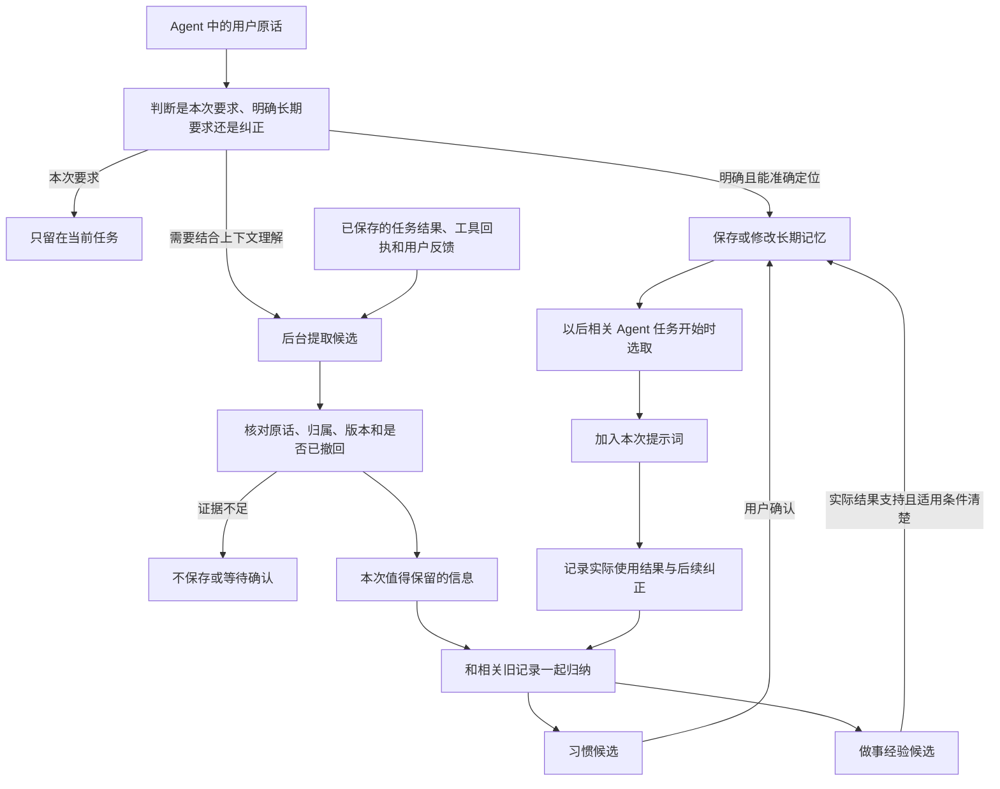

# macs 记忆系统完整升级方案

更新日期：2026-10-13。

状态：**设计方案，尚未全部实现。** 本文区分当前代码、拟新增能力和外部参考；不把研究项目的功能当成 macs 已有功能。

2026-10-14 已实现首期 Go 核心：普通本机 Web Agent 的终态复盘队列、原话/工具依据、待确认候选、独立任务习惯门槛、模型调用限额、提交检查、人工修改保护与旧复盘输入防复活。入口与限制见 [当前实现](memory-service.md#agent-任务后的记忆整理)。这不代表下述全部阶段已经完成。

**已确认的产品边界：记忆系统只服务 Agent 模式。简单问答只使用当前对话上下文，不读取长期记忆，不自动保存偏好，也不参与后台记忆归纳。**

阅读建议：先读第 1～5 节了解用户实际得到什么、AI 怎样记住；第 6～13 节是实现规则；第 14～16 节是升级顺序和验收；附录汇总开源与产品调研。

当前运行合同见 [统一记忆服务](memory-service.md) 和 [记忆来源与运行路径](memory-system-summary.md)。本文是后续升级的完整目标，延续 [个人版记忆设计](personal-memory-design.md)，不改变尚未迁移的现有合同。

## 1. 我们要做的记忆是什么

记忆是：**从过去的交流、任务和资料中，保留以后做事有用的信息，在相关任务中拿出来使用，并允许用户查看、修改和删除。**

用户打开记忆，首先应该看到具体内容：

> 给客户甲做报价时，默认交付 Excel 文件。
>
> 什么时候用：给客户甲做报价时。
>
> 根据哪句话：“以后给客户甲报价，直接给 Excel，别发 PDF。”
>
> 最近修改：10 月 13 日。［查看原任务］［修改］［删除］

以上客户、任务和原话都是说明方案的虚构例子，不是已有用户记录。

用户不需要理解数据库、向量、三元组、namespace、scope 等词。开发内部保留必要结构，界面直接回答四件事：

1. AI 记住了什么？
2. 以后遇到什么事情会用？
3. 为什么会记住，能不能看到当时的原话或结果？
4. 记错了怎么改，不想用了怎么删？

### 1.1 不同内容怎样处理

| 内容 | 用户能理解的例子 | 是否作为长期记忆使用 |
| --- | --- | --- |
| 明确的长期要求 | “以后给我写周报，先写结论。” | 保存后在相关 Agent 任务中使用 |
| 从多次选择发现的习惯 | “你几次都把报告改成一页摘要。” | 先提出新发现，确认后使用 |
| 客户或项目的约定 | “客户甲的报价用 Excel；客户乙需要 PDF。” | 只在相应客户、项目或事项中使用 |
| 做事经验 | “这种表格需要先检查合并单元格，才能可靠填写。” | 有实际检查和结果支持后，在类似任务中使用 |
| 失败教训 | “这个环境没有某个依赖，上次直接执行失败。” | 保留当时条件；再次操作时先核实环境 |
| 知识资料 | 产品手册、用户笔记、经过保存的研究资料 | 按任务检索需要的正文片段 |
| 任务历史 | 上次要求、执行过程、结果、交付物 | 保存在“全部任务”；记忆引用它，不把所有历史堆到记忆列表 |
| 当前对话上下文 | 这次正在讨论什么、用户刚改了哪个要求 | 由会话系统维护，不作为记忆管理的独立分类 |
| 尚未完成的待办 | “等客户确认后再出最终报价。” | 由任务/待办系统维护；相关 Agent 可查询，不当成已发生事实 |

“用户、客户、项目、全局”回答的是**这件事对谁、在哪里适用**，不应和“偏好、经验、知识”混成一堆平行分类。

当前 macs 的全局共享是同一用户、同一工作区内跨助手共享，不是所有注册用户共享。对普通用户可显示“所有助手共用”；企业团队共享以后单独实现明确授权。

### 1.2 模式边界

| 入口 | 长期记忆读取 | 自动学习与归纳 | 说明 |
| --- | --- | --- | --- |
| Web Agent | 支持，按权限与当前任务选取 | 支持，按本文规则升级 | 首期主要实施入口 |
| 简单问答 | 不接入 | 不接入 | 保留当前会话上下文，不调用 Agent 记忆流程 |
| 独立图片、音乐等直接生成 | 不接入 Agent 记忆循环 | 不接入 | 不因为保存了生成历史就自动学习 |
| Agent 调用图片、文件等工具 | 可使用符合本任务的记忆 | 可保留真实工具结果与后续反馈 | 工具返回成功不等于产物已验收 |
| AgentOS、AI 员工、工作流、聊天渠道中的 Agent | 逐入口接入 | 逐入口接入 | 必须先完成身份、终态和权限适配；不因共用运行时自动放开 |
| 记忆管理窗口 | 查看当前可管理内容 | 打开页面不触发学习 | 不调用模型，不扫描全库，不依赖当前选中的会话 |

**模式切换不能绕过边界：**同一会话内 QA 消息可以继续作为本次对话上下文，但不能因切换到 Agent 而被批量纳入长期学习。每条证据携带宿主确认的原始模式；后台只处理合格的 Agent 回合。旧记录无法确定模式时，不自动晋升。用户后来在 Agent 中明确要求保存某件事，以这条新要求作为写入依据。

## 2. 方案的主要决定

1. **保留 macs 的 Go 单二进制与 SQLite/MySQL。** 不要求普通用户再部署 Python、图数据库或第三方记忆服务。
2. **明确要求及时记住，推断习惯后台整理。** 不把每句话都另交模型分析，也不等整个长任务结束才处理明确要求。
3. **原始记录和归纳结论分开。** 原任务是凭据，记忆是一句可复用的结论；两者能互相打开。
4. **模型负责理解，代码负责检查。** 代码检查原话是否存在、是谁说的、是否已删除、版本是否变化；不能假装这些检查能证明推断一定正确。
5. **首期推断习惯必须确认后才生效。** 多次出现、模型自称高置信度、检索次数多，都不能自动变成用户承诺。
6. **用户修改优先。** 后台不得覆盖用户刚改好的记忆，也不得把已删除记忆从旧历史里重新生成。
7. **只把有用的少量记忆送入当前 Agent 提示词。** 能保存、能检索、已送给模型、确实帮助完成任务，是四个不同事实。
8. **Obsidian 是可选的阅读、编辑与资料入口。** macs 继续决定哪些内容生效、何时使用和怎样撤回。

## 3. 开源系统实际怎样识别和归纳

这里按“何时触发、模型看什么、保存什么”对比。GitHub 主分支代码不等于每个已发布安装包都具备相同行为。

| 系统 | 什么时候处理 | 模型看什么、怎样归纳 | 对 macs 的启发 |
| --- | --- | --- | --- |
| [Hermes](https://github.com/NousResearch/hermes-agent/blob/6e7b83a2f1c093e992a8d838ed77ea320fbd8e51/agent/background_review.py) | 回合结束且达到记忆/Skill 计数条件后，启动后台复盘 | 读取对话快照，找用户纠正、可复用办法与排障经验，调用记忆或 Skill 工具保存 | 单独复盘可行；没解决的失败不能被写成可靠做法 |
| [OpenViking](https://github.com/volcengine/OpenViking/blob/bd78cbe57acd721df08e12052fff794813263f76/docs/en/concepts/08-session.md) | 会话 commit 先存档，随后后台生成摘要和提取记忆 | 对话、已有记忆及分类规则交给模型，形成结构化更新 | 存原文、做摘要、提炼记忆是不同步骤，处理进度可查询 |
| [Hindsight](https://github.com/vectorize-io/hindsight/blob/610c135b6f2d0d8b972da94146ae635943f36271/skills/hindsight-docs/references/developer/observations.md) | 应用提交 retain 后先提取事实；开启自动整理时，保存后再排后台归纳 | 第一次摘出本次信息；第二次比较新事实、旧结论及其依据，更新规律 | 最适合参考“先记录，再归纳习惯”的结构；不必等整个 Agent 任务结束 |
| [Mem0 开源版](https://github.com/mem0ai/mem0/blob/d26ba5e4518cef7fff3c66d4f715b21adf9feabe/mem0/memory/main.py#L918) | 应用调用 add 时处理 | 最近消息与相关旧记忆交给模型，提取新条目，再去重保存 | 接口简单；当前核验路径为新增式提取，不应把托管平台 Dream 当成开源默认能力 |
| [LangMem](https://github.com/langchain-ai/langmem/blob/48e3c11f5bb527282c7d5339c6a87a0b35abccfc/docs/docs/guides/delayed_processing.md) | 可在对话中调用工具；也可等一段时间没有新消息后归纳 | 应用提交消息，归纳器读取已有记忆并提出更新 | 等用户连续说完再处理，减少重复调用；应用必须自己提交完整所需上下文 |
| [Letta Code](https://github.com/letta-ai/letta-code/blob/2943efe47e8c49e8ef2b78df100ba8e262c2415a/src/agent/subagents/builtin/reflection-v2.md) | 明确保存与后台反思分开；MemFS 默认反思与上下文压缩事件关联 | 明确记忆代理不推断偏好；反思代理从多会话寻找反复模式 | 明确要求和推断习惯不能走同一可信度规则 |
| [CrewAI](https://github.com/crewAIInc/crewAI/blob/c0eda9f53889fb38d0352e2c9a738c653ab811b3/lib/crewai/src/crewai/agents/crew_agent_executor.py#L251) | 获得最终答案后抽取，但可能早于外层任务验收 | 任务要求、Agent 角色、预期结果与实际输出交给模型 | 不能只因为“模型答完了”就认定经验成功；macs 要等宿主确认任务终态 |
| [Obsidian Copilot](https://github.com/logancyang/obsidian-copilot/blob/4.0.14/src/memory/UserMemoryManager.ts) | 已核验的兼容聊天链在新建对话时总结旧对话；明确更新要求触发长期记忆合并 | 最近对话生成短摘要；旧记忆与用户新说法合并到 Saved Memories 文件 | 可读、可编辑；摘要不等于长期偏好，整篇覆盖需要更严格的版本保护 |

### 3.1 一句话怎样变成记忆

不是数据库自行理解，也不是向量检索自行产生习惯。常见做法是**额外调用语言模型，要求它从限定内容里提出结论**，然后由程序核对、保存。

下面是 macs 的目标行为，不是所有外部项目都已经做到：

| 用户表达 | 应该得到的处理 |
| --- | --- |
| “这次报价给 Excel。” | 只影响本次任务，不生成长期偏好 |
| “以后给客户甲报价都用 Excel。” | 记住“给客户甲做报价时默认交付 Excel” |
| “怎么又给 PDF？之前说过客户甲要 Excel。” | 找到客户甲的既有要求，核对当前任务是否违反；已有正确记忆就补反馈，不再生成重复记忆 |
| 用户多次主动把同类报告改短 | 可提出“这类报告可能更喜欢简短版本”，先待确认 |
| “客户乙喜欢详细一点。” | 记录客户乙的要求，不推导为当前用户所有任务都喜欢详细 |
| “字体太小了。” | 先理解为当前界面或产物的修改意见，不直接推导为所有文档的永久字号偏好 |

多次出现也不一定是习惯：可能是同一个任务反复返工、模板默认值、没有其他选项，或一次临时要求被重复引用。必须回查真实原话与独立任务。

## 4. 整体运行流程



简单问答不进入这条流程。后台处理所需的新记录来自持久化事件，不从当前浏览器窗口临时抓取。

需要区分三条时间线：

- **当场处理：**用户手动新增、修改、删除，以及能准确识别的明确长期要求。
- **一次任务之后：**归纳已经实际发生的操作、结果和问题。失败任务也能留下教训。
- **积累之后：**把多个独立任务的新信息与相关旧结论放在一起，发现习惯或可复用规律。

后台归纳可以在任务结束或会话安静下来后执行；不要求每条消息都新增一次模型调用，也不要求每天固定做全库“大总结”。

## 5. 用户可以看到的完整过程

### 5.1 明确要求

1. 用户在 Agent 中说“以后给客户甲的报告先写结论”。
2. 系统保存“客户甲的报告：先结论，后数据”，同时保留这句原话。
3. 轻量提示“已记住，可修改”，不弹出阻断任务的确认框。
4. 下次给客户甲写报告时，把这条要求交给 Agent。
5. 给客户乙写报告时不使用它。

若不能准确确定“这个客户”指谁，当前任务仍按对话继续；长期记忆先不生效，不凭空绑定最近一个客户。

### 5.2 发现习惯

1. 几次独立的同类报告任务中，用户主动要求更简短。
2. 后台提出“给客户甲的报告，可能更适合一页摘要”。
3. 记忆页显示“有 1 条新发现，待你确认”，并列出实际发生的例子。
4. 用户可以选择“记住”“修改后记住”“忽略”。
5. 确认前不把这个推测当长期要求送入普通 Agent 提示词。

### 5.3 从返工中学习

1. 工具生成了表格，但用户指出列名填错。
2. 把纠正关联到那次任务、具体交付物或采用的记忆。
3. 修复后运行检查；只有检查通过，才可以记录“先核对列名再填写”的已验证办法。
4. 没修好的情况保存为“仍未解决的问题”，不能写成成功方法。
5. 下次遇到相同结构的表格，先使用这条经验，再根据当前文件检查是否仍然适用。

### 5.4 编辑与删除

用户把“默认 Excel”改成“先给 PDF，确认后补 Excel”，后续任务使用新要求。打开过旧页面的另一端不能静默覆盖它。删除后，旧任务仍可以在任务历史查看，但不能再次把相同旧记录自动提炼成这条记忆。

## 6. 识别与提取：模型做什么，代码做什么

### 6.1 可信输入

宿主先保存事件，固定身份和原始内容，至少包含：

- 原始用户消息及角色，不使用已经拼入旧记忆的 prompt 反推“用户说过什么”。
- 消息所属任务、回合和宿主确认的运行模式。
- 能核对的工具执行回执、产物检查结果、用户反馈。
- 原始内容版本和发生时间。
- 用户有权访问的客户、项目或事项标识；没有可靠映射时不能由模型发明 ID。

助手复述、检索出的文章、工具返回的网页和已有摘要都不能冒充新的用户声明。它们可以帮助理解上下文，但没有资格自动建立“用户偏好”。

### 6.2 快速处理明确要求

保留现有 `RecordExplicitUserTurn` 的保守规则，继续处理简单、明确的“记住”“以后默认”等请求。手动编辑已有记忆直接保存，不先让模型改写用户文本。

自然语言较复杂时，使用受限的提取模型理解“这个要求针对什么事情、是否明确长期适用”。首期该模型只产生候选；只有用户明确确认或直接编辑后才生效。不能仅因为模型返回 `explicit=true` 就越过确认规则。

用户明确选择了某条记忆并要求修改、删除时，可以直接定位它；普通对话里的“这个不对”需要关联目标，不能猜测并批量修改相似记忆。

### 6.3 一次任务的信息提取

宿主确认任务终态并成功持久化后，准备有界输入：新用户消息、关键纠正、真实工具回执、验收结果、少量相关旧记忆。

不默认发送完整多年历史，不保留或要求模型输出隐藏推理过程。需要说明时只保存简短、可观察的理由，例如“用户在原任务要求交付 Excel”。

提取结果按严格结构返回，最多包含约定数量的候选和操作建议。以下仅为拟定内部合同示例，不是现有 API：

```json
{
  "operation": "propose",
  "content": "给客户甲做报价时，默认交付 Excel。",
  "when_to_use": "给客户甲制作报价文件时",
  "claim_type": "explicit_preference",
  "subject_ref": "customer_from_input_1",
  "evidence": [
    {
      "source_ref": "message_from_input_3",
      "revision": "host_supplied_revision",
      "quote": "以后给客户甲报价，直接给 Excel"
    }
  ],
  "target_ref": null
}
```

`subject_ref/source_ref/target_ref` 只能选择宿主本次提供的有限引用。模型不得传任意表名、路径、tenant、user_id 或数据库主键进行读写。

### 6.4 程序必须检查

1. 结构合法，数量、长度与操作类型没有超限。
2. 引用属于本次提供的内容，原话真实存在且版本未变化。
3. 原始运行模式允许记忆处理；QA 内容不能通过摘要或工具转述混入。
4. 原话与目标属于当前授权用户、工作区、助手及项目。
5. 目标没有被删除、停用、人工修改或被新版本替代。
6. 工具是否成功、任务是否完成、是否验收来自持久状态，不能采用模型自报。
7. 重复内容只增加合法的新证据关联，不重复创建卡片。
8. 自动推断不直接改写已确认内容；修改现有结论必须经过对应版本检查。

**原话核对只证明“这句话确实出现过”，不证明模型概括一定正确。** 推断习惯的确认、经验的客观验证仍是独立步骤。

## 7. 后台归纳：怎样学到习惯和经验

### 7.1 两阶段归纳

第一阶段提取“本次值得保留的信息”；第二阶段才比较“以前是否也这样”。两阶段可共用同一个模型供应商，不要求另部署一个模型，但都是可计量的额外调用。

第二阶段输入：

1. 本次尚未整理的新证据。
2. 同一用户、同一事情下相关的旧结论。
3. 旧结论所依据的原话和结果。
4. 已经明确拒绝、删除或人工改过的约束。

模型可以建议：不变、新增候选、补充依据、合并重复候选、提出对旧结论的修订。后台不能直接把用户确认的记忆大段重写。

### 7.2 习惯的成立规则

- 用户明确说“以后都这样”，不需要凑次数。
- 没有明确长期表达时，只能形成习惯候选。
- 可把“至少 3 次独立任务出现相似主动选择”作为首期候选提示门槛；这是待评测的工程默认值，不是判断真假的定律。
- 同一任务返工、同一消息复制、重试、摘要、导出再导入，只算同一条依据。
- 被迫选择、程序默认值、模型自己选择、没有被用户否定，不足以证明偏好。
- 用户确认的是具体一句话；不能把确认一项任务扩大为认可所有推断。
- 否认后保留最小拒绝标记，不反复用同一批旧资料打扰用户。

### 7.3 摩擦增强记忆

“摩擦”包括用户纠正、重复返工、工具失败、验收失败、人工接管以及修复后的成功。

先记录发生了什么，再决定学到了什么：

| 实际发生的事 | 可以提出的结论 | 不能直接推出 |
| --- | --- | --- |
| 用户指出客户甲需要 Excel | 客户甲报价格式要求应核对或更新 | 所有客户都禁止 PDF |
| 某工具在当前环境失败 | 该条件下存在失败案例，下次先检查条件 | 这个工具永远不可用 |
| 方法 B 修复了失败并通过检查 | 在相同条件下可考虑方法 B | 方法 B 适合所有任务 |
| 用户反复要求减少解释 | 当前场景可能需要更简短的表达 | 用户在所有领域永远不要说明 |

需要保存的经验是一句能指导行动的话，并关联：当时的条件、失败表现、尝试的修复、实际检查结果。情绪标签、“踩过坑”或失败次数本身不能当经验正文。

摩擦强度用于安排“哪些问题优先复盘”，不直接提高结论可信度。调用成功率、被检索次数也不等于经验正确率。

### 7.4 经验与 Skill 的关系

首期先形成可编辑经验。多次验证有效、步骤清楚的经验，后续可以生成 Skill/SOP 草稿，由用户确认后发布。

已有 `workflow_learner` 能从实际界面操作形成可复用方案，升级应复用它的执行与评测能力，不另写平行执行器。后台不默认改写已安装 Skill，也不能把演示中的客户数据、样品值或结果写入通用 SOP。

## 8. 下次任务怎样使用记忆

### 8.1 读取顺序

1. 宿主确认这是允许读取记忆的 Agent 回合。
2. 获取可信身份、当前工作区、助手、项目及当前任务明确关联的客户/事项。
3. 读取少量已确认的常用要求，以及本次任务相关的偏好、经验和知识片段。
4. 排除候选、停用、过期、已删除、依据失效及版本不一致的内容。
5. 在剩余候选中使用关键词、向量和必要的关系查询选取相关内容。
6. 去除重复，控制提示词长度；临发送前再次核对撤回与版本。
7. 把选中内容作为有来源的历史参考送给 Agent，并记录实际发送版本。

向量只是帮助找到相近内容。它不能决定用户权限，不能把客户甲的习惯合并到客户乙，也不能替代冲突处理。

### 8.2 如何选择几条有用内容

- 少量已确认的通用偏好可以常驻，例如回答语言；不能因当前问题短就漏掉。
- 客户与项目要求先核对当前任务是否匹配，再决定使用。
- 经验按任务类型、操作条件和已验证结果检索。
- 知识资料先找到文章/笔记，再取相关原文；图谱关系不能冒充完整文章。
- 旧任务按需查询目标、结果和关键步骤，不默认塞入所有聊天。
- 较新的有效版本优先，失效信息只用于明确的历史查询。
- 低相关或没有合适记忆时，允许一条也不使用。

先做确定性资格筛选，再做排序。首期不要用一条复杂加权分数同时决定权限、真实性、相关性和优先级。

### 8.3 冲突与当前要求

当前任务明确说“这次给 PDF”，可以覆盖已保存的“通常给 Excel”，但不永久修改默认。用户说“以后改成 PDF”，才更新长期要求。

更具体的要求仅在同一事项且明确匹配时优先。客户甲和客户乙不同的要求可以并存；“使用 Go”和“使用 Python”也可能同时成立。不能因为文字相似或新记录更晚就删除旧内容。

AGENTS.md 等项目说明仍走现有项目指令加载链。它们不是普通经验，不参与自动偏好合并；记忆也不能改变工具权限和审批规则。

### 8.4 怎样证明真正使用了

记录四种不同结果：

| 记录 | 能证明什么 |
| --- | --- |
| 管理页可见 | 当前保存了这项内容 |
| 检索命中 | 这次选取过程找到了它 |
| 实际请求包含 | 这个版本确实被送给模型 |
| 后续检查或用户反馈 | 有证据说明这项要求被遵守、经验有用或需要纠正 |

模型 HTTP 请求成功不能标为“记忆有效”。前端默认只说“最近加入回答参考”，效果另以实际检查或明确反馈说明。

用户不需要挑选一个历史会话才能管理未来使用的记忆。查看某次请求的详细收据属于可选高级功能。

## 9. 存储与 Go 模块设计

### 9.1 复用现有实现

| 当前实现 | 已有内容 | 本方案补充 |
| --- | --- | --- |
| `internal/memory/service.go` | Entry、candidate/active/deleted、版本更正、确认、遗忘、部分来源字段 | 多条证据、完整变更记录、细化生效与撤回合同 |
| `internal/memory/explicit_user_memory.go` | 保守识别明确要求，防重复、防覆盖、防复活 | 保留入口；复杂表达另走候选归纳 |
| `internal/memory/processing.go` | summary/derive 持久任务、租约、重试 | 扩展提取、归纳与重算任务；补通用提交检查与常驻调度 |
| `internal/memory/deriver.go` | 模型提取图谱事实，并核对用户原话 | 规范记忆与原始事实关联；不能把图谱结果直接当确认偏好 |
| `internal/memory/recall*.go` | 相关召回、预算、向量、撤回与诊断 | 统一最终资格检查、客户/事项条件、效果反馈 |
| `internal/memory/source_recall_control.go` | 原来源自动参考开关 | 与结论血缘联动；不误称原文已删除 |
| `internal/app/memory_*.go` | 可信身份、来源清单、管理 API、来源编辑 | 接入真实反馈和权威终态，扩展页面 DTO |
| `internal/app/prompt_memory_*.go` | 部分 Web Agent 实际请求的来源追踪 | 按入口逐步覆盖；保持生成与实际发送的区别 |
| `web/memory*.js`、`web/memory*.css` | 记忆管理与阅读界面 | 一句话卡片、清楚的详情、候选确认、改删与更新记录 |

现有自动明确写入限制单行和 300 字符以内；旧 `LearnNote/Insights` 中部分内容来自答案摘取，不是完整独立复盘。现有队列也不是已经运行的全功能后台记忆服务。

### 9.2 数据分成三层

1. **原始证据：**复用消息、任务、工具回执与资料，不重复复制整个 transcript。
2. **可使用的结论：**复用 `memory_entries` 作为权威集合，一条记忆一句主要结论。
3. **可重建的检索数据：**向量、全文索引、图谱投影与摘要索引，不作为唯一事实来源。

知识库原文继续由知识库管理；当前会话与任务 checkpoint 继续由会话/任务系统管理。

### 9.3 拟新增的数据合同

以下表名和字段是实施建议，需要迁移评审后落地，不是当前已经发布的 Schema。

| 对象 | 建议内容 |
| --- | --- |
| Entry 扩展 | 表达类型、针对的业务对象、可检查的使用条件、有效期、人工确认/编辑标记；保留现有主键与 Version |
| `memory_evidence` | 记忆 ID/版本、原始记录定位与版本、原话引用、宿主确认的角色和模式、独立事件标识 |
| `memory_relations` | 由哪些结论/证据产生、替代了哪条、支持或反驳了哪条；支持撤回后找出受影响内容 |
| `memory_changes` | 谁在何时新增/修改/确认/停用/删除，修改前后版本；隐私删除时正文另按删除策略清理 |
| `memory_feedback` | 指向哪次回答、任务、交付物或记忆版本，用户原话、客观检查结果与处理状态 |
| 现有 processing jobs 扩展 | 输入水位/版本、策略代数、业务终态版本、模型预算与结果提交版本 |
| 现有 recall/input 记录扩展 | 原始记忆版本、实际发送与检查结果的关联；不再建一套重复调用日志 |

证据数量按独立原始事件计算；多个摘要引用同一消息不会增加支持次数。

Entry 的客户/事项条件与已有 user/project/global/session 范围分开。客户 ID 只是筛选条件，不赋予额外访问权限。

### 9.4 生命周期

现有状态只有 candidate、active、deleted。拟新增暂停、失效、被替代等能力时，要同步所有读取者、API、导出与迁移，不能只改前端标签。

| 用户看到的状态 | 含义 | 可以进入普通 Agent 提示词吗 |
| --- | --- | --- |
| 待确认 | 模型发现了可能有用的结论 | 不可以 |
| 已记住 | 用户明确要求、手动创建或确认；经验有对应验证 | 匹配本次任务时可以 |
| 暂停使用 | 暂时不希望 AI 参考，内容保留 | 不可以 |
| 需要重新核对 | 原依据被修改、撤回，或环境已变化 | 默认不可以 |
| 已更新 | 被新要求替代的历史版本 | 不作为当前要求；可在更新记录查看 |
| 已删除 | 不再作为记忆使用 | 不可以，旧任务不能自动复活它 |

实现上可先复用现有 candidate/active/deleted 与开关，再逐步迁移状态模型；每个阶段必须保证旧读取路径不会把暂停或失效内容当 active 使用。

### 9.5 模块职责

领域算法、结构校验、证据关联、归纳决策和队列处理放在 `internal/memory/`。宿主 `internal/app/` 只提供可信身份、原始回合、任务终态、模型调用适配、生命周期和 HTTP 绑定。

继续使用 `agent_memory` 及现有 Tool Registry；不另建一套平行的记忆工具发现系统。模型接口通过窄接口注入，所有外部调用绑定 context、超时和取消。

## 10. 后台调度、重试与费用

### 10.1 调度时机

- 明确手动增改删不进入慢速归纳队列。
- 合格 Agent 任务的权威终态落库后，提交增量提取任务。
- 一段时间没有新的合格 Agent 消息时，可归纳已保存的新信息。
- 只处理变化的内容及相关旧结论，不周期性重读全量历史。
- 用户在归纳等待期继续发消息，更新待处理水位；不能只替换最后一条消息而丢掉前面尚未处理内容。
- QA 事件不会推动记忆水位或触发归纳；处理范围不能采用混有 QA 的整个 session 文本。

### 10.2 可靠提交

复用 `memory_processing_jobs`，扩展任务类型。当前已有租约和重试，但新写入要在**提交 Entry、证据与关系的同一事务内**核对：worker 租约仍有效、输入版本未变、来源未撤回、策略未关闭、目标版本未被人工修改。

在最后更新 job 状态时才检查租约不够，因为旧 worker 可能已经提前写入。取消 goroutine 也不能撤销已发出的模型请求；过期结果必须在提交时被拒绝。

幂等标识至少绑定授权范围、原始事件、输入修订和任务种类。自动重试不增加支持次数。SQLite/MySQL 行为都要验证，不依赖某一数据库的 affected rows 巧合。

宿主确认终态后应留下可补偿的持久事件/水位。重启时补上“任务已完成但还没入归纳队列”的工作；不重新执行原业务工具。

独立图谱库、文件和应用数据库之间不宣称原子事务。应用数据库先使旧版本不可召回，再通过可重试任务更新外部投影。

### 10.3 首期费用控制

以下为待评测的初始限制，不是外部系统的统一标准：

- 同一用户/工作区同时最多运行一个归纳任务。
- 默认等待 60 秒无新增合格 Agent 消息再归纳，可由配置调整。
- 单次提取最多产生 5 条候选；单次归纳最多处理 20 条新证据及有限相关旧内容。
- 设独立输入、输出 token 上限、每日调用次数和费用上限；具体值由本机或企业配置决定。
- 无值得保存的新信息时允许返回空结果，不为凑数量制造记忆。
- 模型超时、余额不足、结构错误时保留原始记录并延期；不影响已完成主任务，不清空已有记忆。
- 使用平台模型时，后台调用需要明确属于“记忆整理”的计量记录，复用已授权的模型调用与扣费通道；具体计费策略上线前单独确认，不偷偷增加一套扣费接口。
- 不允许归纳器无限调用工具、联网或执行 Shell；只开放受限的记忆读取和提交能力。

普通用户设置可以显示“自动记住明确要求”“发现习惯和经验”“使用已有记忆”，并提供总开关。关闭自动归纳仍可查看和修改已有记忆；关闭使用不删除原任务。

## 11. 纠正、暂停与遗忘

### 11.1 纠正

用户修改某条结论后创建新版本，旧版本退出当前召回。后台只能提出与人工版本相关的修订建议，不能静默覆盖。

如果只是增加不同客户、不同场景的要求，保留两条，不合并成互相矛盾的一句话。同一事情的新要求确实替代旧要求时，保存替代关系。

### 11.2 暂停

“暂停使用”保留内容和依据，停止自动参考。当前已有原来源开关只实现部分路径；升级必须覆盖被暂停来源产生的结论，不能只让原文卡片变灰。

暂停与记忆删除的适用范围要明确。原任务历史仍可阅读；直接打开原任务不是恢复自动使用的授权。

### 11.3 删除与防复活

“删除这条记忆”的首要承诺是：后续记忆读取和自动学习不能继续使用或重建它。

1. 在应用数据库标记删除，清理该记忆正文与对应引用负载，保留不含正文的最小删除标识。
2. 立即从所有记忆召回、记忆工具读取、缓存命中和待提交结果中排除。
3. 找出依赖它的摘要、习惯、经验、图谱投影和索引，先停止使用，再清理或重算。
4. 若某结论同时依赖 A、B，撤回 A 后只用剩余合法依据重新评估，不把无关的 B 一并删除。
5. 在途模型结果、重启恢复、历史重扫、索引重建和旧文件同步都必须检查删除标识。
6. 用户明确重新添加时创建有新授权依据的版本；普通新任务不算恢复授权。

删除标识不能只绑定 Entry ID。它还要绑定授权范围、原始证据的稳定定位与修订、被删除结论的稳定标识及派生关系；清理正文后仍保留不含原文的必要匹配信息。旧证据经重新摘要、改写或生成新 Entry ID，不能绕过撤回检查。无法可靠判定是否属于已删除结论时，不自动生效；同时不能把同一原始事件中无关的其他事实一并删除。

“删除记忆”不等于删除全部聊天、文件备份与第三方副本。原任务历史的删除、账号数据清除、备份保留有单独入口和策略。不能把仅停止 prompt 使用宣传成已物理清除所有副本。

当前会话已包含的用户原话也不是长期召回；改删记忆不能改写已经发送给模型的请求。需要彻底排除旧话时，应重新开始不带旧会话上下文的任务。

## 12. 记忆管理界面

### 12.1 主页面

说明只保留一句：**“这些内容会帮助 AI 处理以后的 Agent 任务，你可以随时修改或删除。”**

建议主筛选为：全部、偏好与习惯、客户与项目、做事经验、知识资料。项目与全局约定放在“客户与项目”中，以“当前项目”“所有助手共用”等易懂筛选呈现；客户、项目名称用于过滤，避免不断增加标签页。

不新增“短期记忆”“原文摘要”“提取记录”“其他来源”等用户无法判断用途的主分类。原始对话和任务仍在“全部任务”，记忆详情能跳转过去。

### 12.2 卡片与详情

卡片正文先显示完整结论，不把数据库标签当标题。下方只显示“用于什么事情”和日期。保留查看、修改、删除；暂停使用可放在更多操作中。

详情弹出独立模态，按顺序展示：

1. 记住的内容。
2. 什么时候使用。
3. 根据哪句话或哪次结果。
4. 最近修改与更新记录。

经验额外说明“当时的问题、采用的办法、怎样确认有效”。技术表名、字段、ID、调用日志放在默认折叠的开发信息里。

“有 2 条新发现，待你确认”作为低干扰入口。打开后有“记住、修改后记住、忽略”，不在每轮对话弹窗。已确认与待确认不混在同一个总数里。

### 12.3 数量与空状态

- 全部数量等于当前过滤条件下、不重复的记忆条目数；按多类标签展示时说明是否重叠。
- 不把三元关系数量、原文切块数量、任务日志数量称为知识文章数。
- 知识条目显示真实标题与正文；没有文章全文的关系记录不能伪装成文章。
- 没有经验时显示“还没有整理出的做事经验”，不展示空白总结壳。
- 旧资料入口说明“这些资料尚未整理成可用记忆”，查看它不自动启用。
- 打开页面、切换筛选、阅读内容都不触发模型或写入。

## 13. Obsidian 接入

### 13.1 它在本方案中的作用

Obsidian 的本地 Markdown、链接和属性适合让人查看、整理和编辑资料；原生笔记库不会自动判断一个行为是不是长期习惯。[官方数据存储说明](https://help.obsidian.md/data-storage)、[属性说明](https://help.obsidian.md/properties)。

已核验的相关组件：

| 组件 | 提供什么 | 不应误认为 |
| --- | --- | --- |
| [Obsidian Bases](https://help.obsidian.md/bases) | 把笔记和属性显示成可筛选的表格、卡片 | 已具备 Agent 的记忆生效规则 |
| [Smart Connections 4.7.2](https://github.com/brianpetro/obsidian-smart-connections/releases/tag/4.7.2) | 相关笔记与语义查找 | 自动确认用户习惯或经验正确 |
| [Copilot 4.0.14](https://github.com/logancyang/obsidian-copilot/releases/tag/4.0.14) | Agent 宿主、笔记操作；部分聊天链有近期摘要和显式保存记忆 | 所有接入的 Agent 共用完全相同的记忆链 |
| [Local REST API with MCP 5.4.0](https://github.com/coddingtonbear/obsidian-local-rest-api/blob/5.4.0/README.md) | 认证读写、搜索、按块/属性修改与版本检查，原生 MCP | 自带习惯归纳和事实核实 |
| [Basic Memory](https://github.com/basicmachines-co/basic-memory) | 人和 Agent 读写同一批 Markdown，建立可检索关系 | 仅连接 MCP 就会监听全部对话并正确总结 |

Basic Memory 的宿主插件另外提供会话开始、上下文压缩时的自动记忆流程；这和单独接 MCP 是不同配置。[Claude Code 插件](https://github.com/basicmachines-co/basic-memory/tree/main/plugins/claude-code)、[Codex 插件](https://github.com/basicmachines-co/basic-memory/tree/main/plugins/codex)。

### 13.2 推荐接法

第一步只连接用户选择的目录，通过已有文件读取或现有 MCP 接口导入知识。普通笔记默认作为可查询资料，只有用户明确选为记忆或确认归纳内容后，才成为长期要求。

第二步提供可选“在 Obsidian 中编辑”能力：macs 管理当前生效版本；向专用目录导出可读 Markdown，并映射稳定记忆 ID 和版本。

```text
用户选择的笔记库/
  macs记忆/
    偏好与习惯/
    客户与项目/
    做事经验/
```

目录名是示意，不硬编码到算法。内部属性由系统维护，用户主要编辑正文。

### 13.3 两端修改怎样处理

- macs 保存生效版本；Obsidian 是编辑入口与外部资料来源。
- 外部文件变化先读回、核对身份映射、版本和删除状态，再生成可审阅变更。
- 不能假定每次文件变化都是用户亲自编辑；其他 Agent 也可能改文件。未能确认的自动写入不越过候选规则。
- 两边同时修改时保留用户草稿和两个版本，提示比较，不采用最后写入无条件覆盖。
- 写回使用稳定 ID、块或属性定位及版本检查，避免整篇覆盖一个公共 Saved Memories 文件。
- 用户删除记忆后，旧文件重新出现不能自动复活它。
- Obsidian Sync 的文本合并不等于语义冲突解决；插件目录选择也不能替代 macs 的用户权限。

暂不采用“Markdown 是唯一权威、macs 只有索引”的模式，以免第一阶段同时重构数据库、版本、删除与身份体系。以后若支持该模式，需要单独完整文件协议。

## 14. 当前差距与分步实施

### 14.1 当前已有、但不能夸大的基础

目前有明确要求写入、Entry 候选与确认、版本检查、部分来源追踪、召回与逐来源暂停。还缺少：

- 对用户反馈指向哪次回答、哪条记忆的统一关联。
- 多条独立原话支持一个习惯的证据关系。
- 可恢复的后台归纳及通用提交版本检查。
- 语义冲突与人工改动保护的完整闭环。
- 从删除的原始依据一路撤回到所有派生结论的能力。
- 跨入口一致的实际提示词收据和效果评估。

旧画像、旧图谱、旧笔记仍可能包含有用内容，但不能因为“库里有”就全部启用。旧图谱未必有足够的用户归属，旧默认值也不等于用户亲口表达的偏好。

### 14.2 实施顺序

| 阶段 | 主要修改 | 用户能验证的结果 |
| --- | --- | --- |
| P0：合同与基线 | 核对真实写入/读取入口，固定 Agent-only 边界与测试数据 | QA 不参与记忆；现有数据不丢失；知道每类信息是否实际进入 prompt |
| P1：记准明确要求 | 用户原话与反馈目标关联，证据版本、去重、人工修改保护 | “以后这样做”能找到原话；“这次这样做”不误存长期；记错能改 |
| P2：后台提取与候选 | 复用持久队列，补宿主终态、租约提交检查、独立事件去重、预算 | 任务后出现少量有内容的候选；失败不会写成成功经验 |
| P3：跨任务归纳 | 新证据与旧结论合并，习惯待确认，冲突修订建议 | 能看懂“发现了什么、根据哪几次”，确认后才使用 |
| P4：真正使用与遗忘 | 最终 prompt 检查、默认偏好预算、结果反馈、派生撤回 | 新任务会按确认要求做；删除后重启、重建索引也不复活 |
| P5：页面整理与旧资料迁移 | 卡片与详情、清楚计数、旧资料可审阅导入 | 主界面只显示能理解的记忆；原任务和资料可追溯 |
| P6：可选扩展 | Obsidian、跨 Agent 显式共享、经验转 Skill 草稿、其他 Agent 入口 | 用户按需连接与分享，不增加默认部署负担 |

P1 起就提供最小可用的查看与改删，P5 是完整交互整理，不把可见性拖到最后。每个阶段都要有开关与独立验收，不一次切换全部旧链路。

P2 自动提取启用前，必须已具备提交时的租约与版本检查、使用前的最终撤回检查，以及按原始证据阻止已删结论复活的基础能力。受影响的派生内容至少先停止使用；完整重算、效果反馈和交互优化可以在 P4 补齐。阶段编号不意味着可以先开放自动写入，再补这些约束。

### 14.3 旧数据迁移

1. 先建立可核对的归属与原文映射，不批量把旧画像转成已确认偏好。
2. Agent/QA 模式无法判断的旧数据不自动用于偏好学习。
3. 原文缺失或只有模型总结的内容，保持旧资料或候选，不伪造证据。
4. 用户确认一条旧资料后，创建明确的新记忆，并保留它来自哪里。
5. 旧 `artifact_format_preferences` 与新 Entry 的权威来源要一次确定、分步切换，不能双向无规则写入。
6. 已删除或被用户修改的内容不能被兼容导入覆盖。
7. 对旧 `history_and_profile` 大块逐步拆成带来源的适配项；未拆分入口不能宣称支持逐条完整遗忘。

### 14.4 回滚

关闭新增自动提取/归纳即可停止新能力，保留手动记忆和现有读取。新增表采用可兼容迁移，不在首版删除旧数据库字段或历史数据。

回滚不能恢复已经删除的记忆，也不能重新启用不认识新状态的旧读取路径。上线前固定兼容版本范围；无法理解新停用状态的版本不得直接回退上线。

## 15. 验收与评测

同时检查三件事：存储内容正确、页面能读懂、实际 prompt 使用正确。只看到卡片或只编译通过，都不算完整通过。

| 场景 | 必须满足 |
| --- | --- |
| 明确说“以后产品主图都用白底” | 在相关 Agent 生图任务中使用，不影响无关写作 |
| 只说“这次换白底” | 不产生长期偏好 |
| 客户甲简短、客户乙详细 | 各自生效，不合成用户全局偏好 |
| 多次独立任务出现相似选择 | 只形成可查看依据的习惯候选，确认前不注入 |
| 同一消息被摘要、重试或导入多次 | 支持次数不增加，不产生重复卡片 |
| 用户指出“又弄错了” | 关联具体任务/结果；不凭情绪标签发明偏好 |
| 用户明确更改某客户默认格式 | 只更新该客户该事项；保留变化记录 |
| 模糊说“这不是我的习惯” | 不批量删除，不猜测目标覆盖旧记忆 |
| 任务失败、取消或只完成部分 | 可留失败事实，不生成已验证成功方案 |
| 工具成功但产物检查失败 | 不把工具成功当任务验收成功 |
| 归纳中用户编辑/删除原话或结论 | 旧结果提交被拒绝，不覆盖人工版本 |
| 向量返回后用户停用记忆 | 最终请求不带入已停用版本 |
| 删除一个被多条结论引用的来源 | 依赖结论停止使用并重算，不误删无关独立依据 |
| 重启、重建索引、重扫历史 | 被删除的记忆不复活 |
| 两个页面同时编辑 | 提示版本冲突，保留草稿，不静默覆盖 |
| 两个用户/项目内容相似 | 搜索、直接 ID 读取、缓存和后台都不能越权 |
| 预算耗尽或模型结构错误 | 主任务不受影响，记录延期/失败，不无限重试 |
| 打开记忆模态、切换分类 | 能查看正文；无模型调用、无隐式写入 |
| 简单问答 | 不调用 Recall、明确写入、归纳队列或记忆工具 |
| QA 后切到 Agent | QA 消息只作为当前上下文，不被自动提炼成长期记忆 |
| 旧记录没有模式或用户归属 | 不自动学习，不默认归入当前用户 |
| Obsidian 两端同时编辑 | 保留冲突版本，不无条件覆盖，不复活已删除记录 |

外部评测可参考 [LongMemEval](https://arxiv.org/abs/2410.10813) 的信息提取、跨会话、时间变化、知识更新和无法确定时不乱答；不能直接拿不同项目的宣传分数比较。

macs 自建固定样例还应统计：错误长期化比例、重复率、无关注入率、删除残留率、用户改动被覆盖次数、每次有效记忆的模型费用、相关任务遵守已确认偏好的比例。正确性与权限失败为硬门槛，不能被平均分掩盖。

测试不使用真实账号或生产记忆。重点测试最终模型请求和重启恢复，不只验证提取函数输出。基线已知失败与本次新增失败分别报告。

## 16. 第一版交付定义

第一版应交付一条完整可验证链路：

> Agent 中明确要求或产生可核对经历 → 保存依据 → 后台提出少量候选 → 用户看懂并确认/修改 → 相关 Agent 任务使用 → 用户纠正或删除后以后立即遵守。

必须包含 Agent-only 模式边界、人工修改保护、候选确认、费用限制和删除防复活。先不做自动发布 Skill、全库自主改写、推断习惯自动转正或默认跨用户共享。

最终用户看到的核心内容仍是一句话：**“AI 记住了什么，以后什么时候会用，我能不能改。”**

## 附录 A：主流方案的完整研究地图

以下覆盖主要技术路线与代表项目，不声称穷尽市场。核验日期为 2026-10-13；源码核验和官方功能描述分别标明。商业服务内部实现无法仅凭文档完全验证。

| 代表 | 类别与已核实重点 | 采用建议与边界 |
| --- | --- | --- |
| [OpenClaw](https://github.com/openclaw/openclaw/blob/7896f10f9ba171a9bf411657703e6116929775f2/extensions/memory-core/src/dreaming.ts) | 完整 Agent；源码有日常记忆、混合检索、后台分阶段整理 | 借鉴分层与整理；检索频繁不等于任务结果验证成功 |
| [Hermes](https://github.com/NousResearch/hermes-agent/blob/6e7b83a2f1c093e992a8d838ed77ea320fbd8e51/agent/background_review.py) | 完整 Agent；小型常驻记忆、历史搜索、后台记忆/Skill 复盘 | 借鉴纠正和失败恢复学习；提示词质量规则不是客观验收 |
| [Letta Code](https://github.com/letta-ai/letta-code/blob/2943efe47e8c49e8ef2b78df100ba8e262c2415a/src/agent/subagents/builtin/memory-v2.md) | 编码 Agent；明确记忆、跨会话反思、文件与 Git 变更 | 借鉴即时/后台分工；删除文件不等于清除 Git 历史 |
| [Claude Code](https://code.claude.com/docs/en/memory) | 官方文档：人工指令文件与自动记忆分开，索引常驻、详情按需读取 | 借鉴简短索引和可编辑正文；指令进入上下文不保证严格执行 |
| [Codex](https://learn.chatgpt.com/docs/customization/memories) | 官方文档：本地记忆后台提取与整理，可分别控制读取和贡献新记忆 | 借鉴读写分离及预算；不把本地 Codex 与 ChatGPT 记忆当同一存储 |
| [GitHub Copilot Memory](https://docs.github.com/en/copilot/concepts/agents/copilot-memory) | 官方文档：仓库事实与用户偏好；仓库事实使用前检查代码出处，未使用内容有过期策略 | 借鉴用前核实；仍为文档标明的预览能力，不能照搬所有产品入口 |
| [Cursor Rules](https://cursor.com/docs/rules) | 当前官方文档：用户、项目、团队规则及按路径/相关性加载 | 借鉴稳定约定与条件加载；不把旧版 Memories 描述当当前所有模式的保证 |
| [Windsurf/Cascade](https://docs.devin.ai/desktop/cascade/memories) | 当前官方文档：旧 Cascade 有本地自动记忆；默认新 Devin Local 不沿用该能力 | 说明必须核对具体运行模式；重要约定可放规则或 Skill |
| [Mem0](https://github.com/mem0ai/mem0/blob/d26ba5e4518cef7fff3c66d4f715b21adf9feabe/mem0/memory/main.py) | SDK/平台；开源当前为新增式提取；平台 Dream 另有合并、替代、习惯归纳 | 借鉴简洁事实 API；区分开源与托管能力 |
| [Graphiti / Zep](https://github.com/getzep/graphiti/blob/2f0fb35b749f1ff17377892e099882176e453393/graphiti_core/utils/maintenance/edge_operations.py) | 开源时序图与独立托管产品；关系有效期、历史事件、冲突失效 | 借鉴“现在是什么、以前是什么”；关系图不必成为个人版必装服务 |
| [Hindsight](https://github.com/vectorize-io/hindsight/blob/610c135b6f2d0d8b972da94146ae635943f36271/skills/hindsight-docs/references/developer/observations.md) | 记忆服务；事实、经历、带依据归纳、按需取证回答 | 重点借鉴两阶段归纳；支持记录存在不保证语义推断正确 |
| [LangGraph](https://github.com/langchain-ai/langgraph/blob/a1ce1972346b2f2a614b7e50775715910024514e/libs/checkpoint/langgraph/store/base/__init__.py) | 框架；线程 checkpoint 与跨线程 Store 分开 | 会话恢复与长期记忆不是一层；框架不替应用决定什么进入 prompt |
| [LangMem](https://github.com/langchain-ai/langmem/blob/48e3c11f5bb527282c7d5339c6a87a0b35abccfc/docs/docs/guides/manage_user_profile.md) | 提取/归纳工具；结构化画像、经历与延迟处理 | 借鉴增量处理；默认模型提取不是仅保存明确事实 |
| [CrewAI](https://github.com/crewAIInc/crewAI/blob/c0eda9f53889fb38d0352e2c9a738c653ab811b3/docs/edge/en/concepts/memory.mdx) | Agent 框架；当前统一 Memory、相关性/时间/重要性评分和合并 | 不再沿用旧三分法介绍；先验收再把经验标为有效 |
| [Google ADK / Memory Bank](https://adk.dev/sessions/memory/) | 框架与云服务；会话存入长期记忆，工具或回调检索 | 分清仅内存原型、原始资料检索和模型提炼服务 |
| [AWS AgentCore Memory](https://docs.aws.amazon.com/bedrock-agentcore/latest/devguide/episodic-memory-strategy.html) | 云服务；用户偏好、任务经历与跨经历反思 | 借鉴任务经过和归纳经验分开；具体召回仍需应用装配 |
| [OpenViking](https://github.com/volcengine/OpenViking/blob/bd78cbe57acd721df08e12052fff794813263f76/docs/en/concepts/02-context-types.md) | 上下文数据库；资料、记忆、Skill，摘要/概览/原文分层 | 借鉴可浏览、按需读详情；无需复制其全部运行栈 |
| [MemOS](https://github.com/MemTensor/MemOS) | 官方仓库说明：统一管理、多种资料、调度与反馈，含本地/云插件 | 可作扩展与对照；各插件能力不等于核心所有部署默认具备 |
| [memU](https://github.com/NevaMind-AI/memU) | 当前官方仓库：共享 Wiki/Skill，宿主会话采集、Agent 归纳与后续检索 | 借鉴跨 Agent 复用；理解工作由 Agent 做，不是存储层自行学习 |
| [EverOS](https://github.com/EverMind-AI/EverOS) | 原 EverMemOS 当前仓库；Markdown、本地索引、用户经历/画像与 Agent 案例/Skill | 借鉴人可读与层次分离；采用前按具体版本验证 |
| [Cognee](https://github.com/topoteretes/cognee) | 官方仓库：资料/代码/对话形成关联知识，提供存、查、改进与忘记 | 适合知识连接与企业资料；抽取关系不等于确认用户偏好 |
| [TencentDB Agent Memory](https://github.com/TencentCloud/TencentDB-Agent-Memory) | 官方仓库：团队 Chat Memory、Skill、Wiki、CodeGraph 资产 | 借鉴团队经验复用；当前团队能力标为 Beta，分享需明确授权 |
| [Basic Memory](https://github.com/basicmachines-co/basic-memory) | Markdown、MCP、关系索引与宿主插件 | 借鉴同文件可编辑；插件触发和核心存储能力要分开说明 |
| Obsidian 及其插件 | 知识载体、检索、Agent 宿主和可选记忆写入 | 见第 13 节；不作为 macs 默认外部依赖 |

## 附录 B：值得借鉴的研究逻辑

- [Reflexion](https://arxiv.org/abs/2303.11366)：把失败后的文字反思用于下一次尝试。适合启发失败教训，不等于生产系统已解决长期身份、撤回和验证。
- [A-MEM](https://arxiv.org/abs/2502.12110)：借鉴卡片笔记，把新旧记忆建立联系并更新组织。关系可以帮助找到材料，但链接不证明结论正确。
- [ACE](https://arxiv.org/abs/2510.04618)：通过生成、反思、整理逐步维护可复用做法，避免反复重写一个摘要时丢失细节。适合参考增量更新。
- [Tellonce](https://github.com/YujunZhou/tellonce/blob/d7696b00e88264b3d506b10703526a15f46a1e29/lib/memory_judge.py)：把用户纠正整理为有条件的规则，要求原话依据，区分一次例外与永久变更。借鉴证据与修改合同，不默认照搬工具强制拦截。
- [Memory in the Age of AI Agents](https://arxiv.org/abs/2512.13564)：从记忆形态、用途、形成/演化/读取整理研究全景。模型参数记忆、隐状态与 KV 缓存属于另外层次，不是本方案让用户逐条管理的历史信息。

本方案优先组合：Hermes 的复盘时机、Hindsight 的证据与归纳分层、Letta 的明确要求与推断分工、Graphiti 的变化历史、Copilot 的用前核实、Obsidian/Basic Memory 的可读可编辑形式。保留 macs 现有 Go、数据库、身份与工具边界，按阶段验证后实施。
