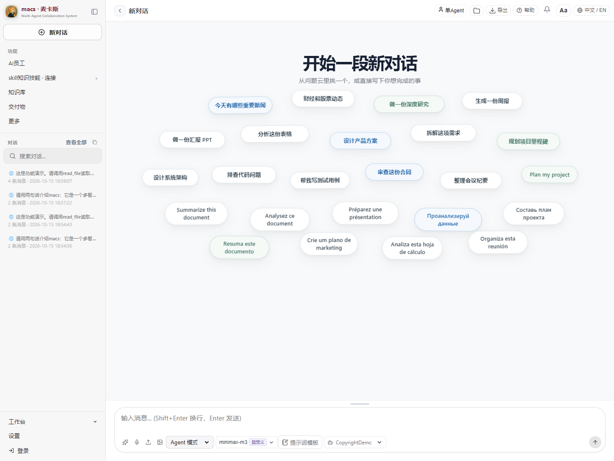
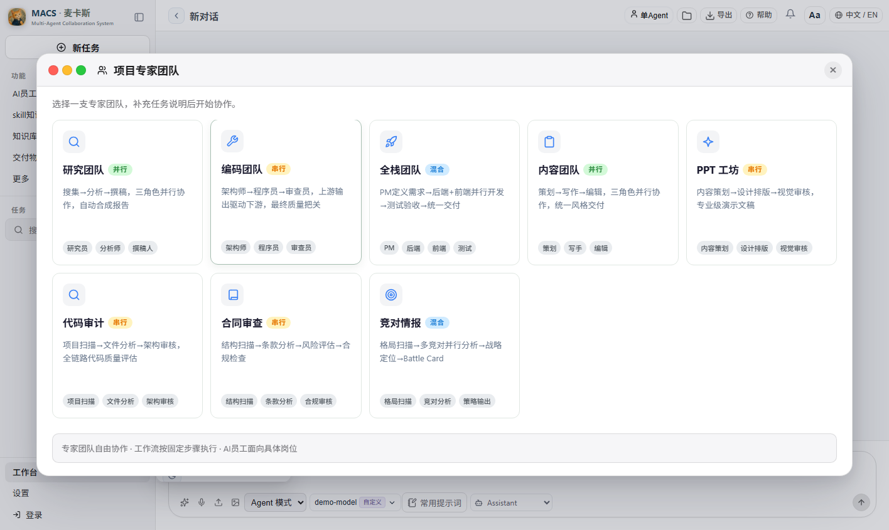
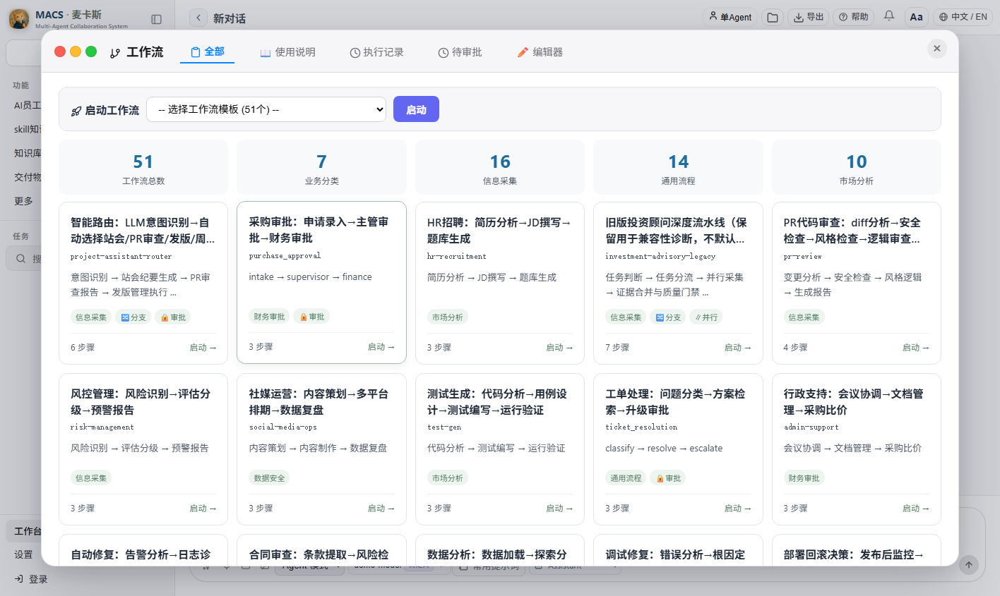
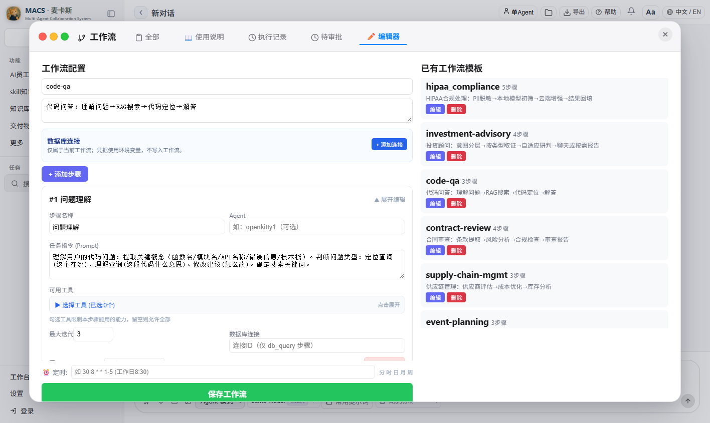
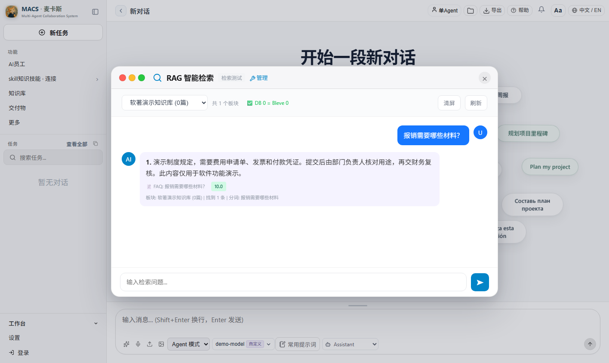
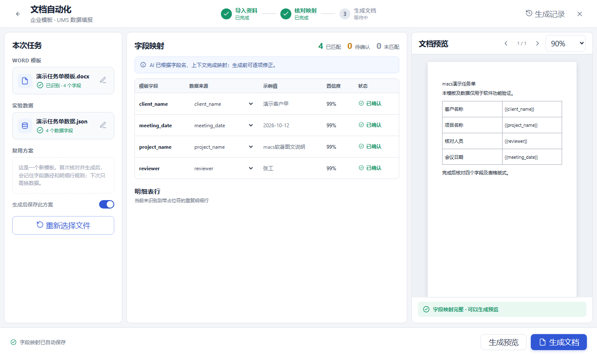
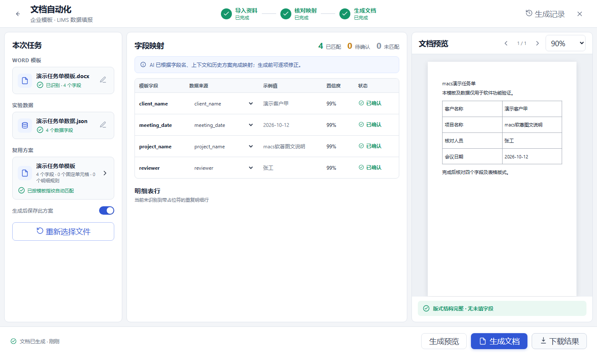
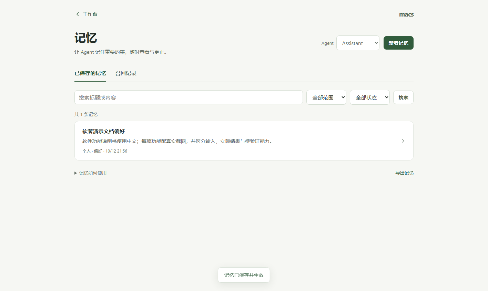

# macs 界面与功能演示

[返回项目介绍](../README.md) · 简体中文 | [English](showcase.en.md)

下面选取了 V1.1.8 功能演示中的 8 张界面截图，覆盖对话、协作、工作流、知识库、文档自动化和记忆。截图使用演示数据，点击图片可以查看原始尺寸。

## 1. 对话与工作台

在同一个界面管理对话、选择 Agent 和模型，并从任务建议开始工作。

## 2. 多 Agent 专家团队

选择研究、编程、全栈开发、内容或审查团队，通过不同角色组织协作。

## 3. 工作流模板

从业务场景选择工作流，查看步骤数量、分类和可用入口。

## 4. 工作流编辑

配置每个步骤的任务说明、Agent 和工具范围，将工作方法整理成可复用流程。

## 5. 知识库检索

演示问题“报销需要哪些材料？”如何从知识库中找到对应内容，并展示答案的来源片段。

## 6. Word 字段映射

导入 Word 模板和结构化数据后，核对字段对应关系、示例值与匹配状态；右侧保留模板预览。

## 7. Word 生成与方案复用

演示任务单填写完成后，可以预览和下载 Word 文件，并保存映射方案用于后续同类模板。

## 8. 记忆管理

查看已保存的偏好与事实，搜索记忆，并进入相关记录查看、更正或管理内容。

[阅读完整使用手册](macs-user-manual.md) · [了解系统架构](../README.md#系统架构) · [查看编译与启动命令](../README.md#从源码编译与运行)
